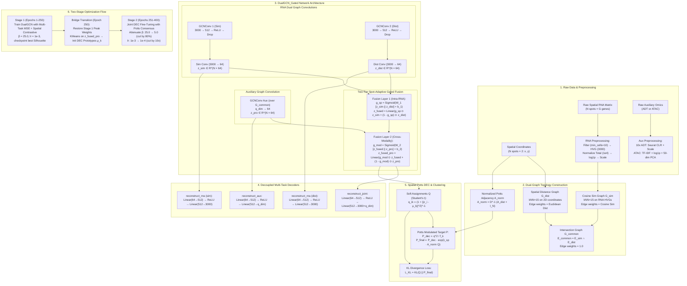
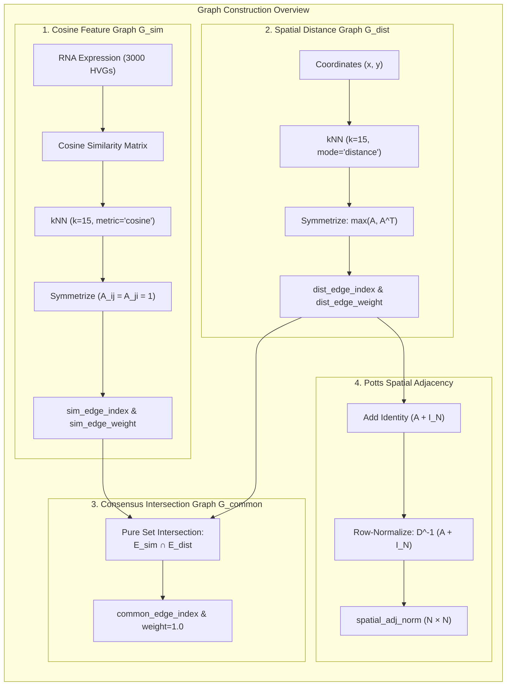
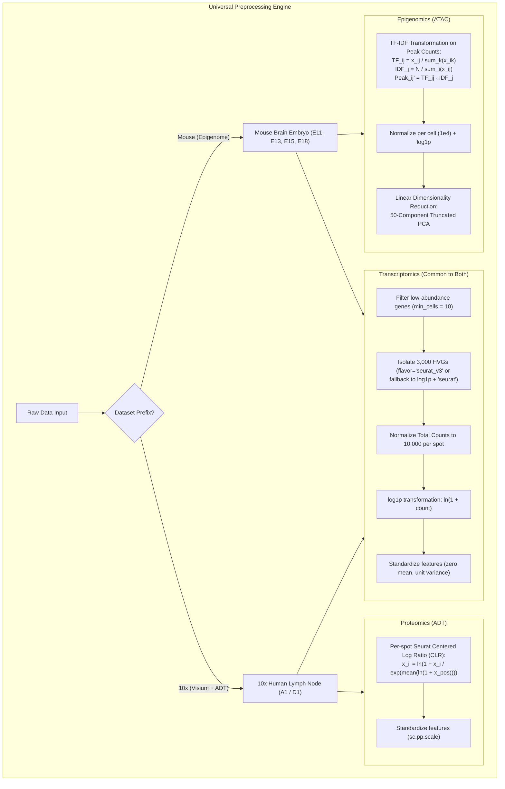
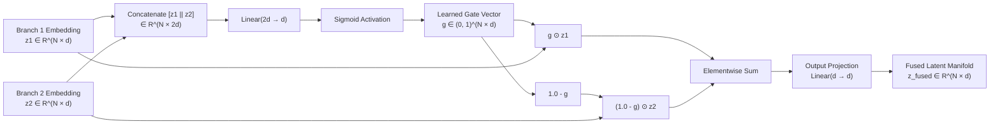
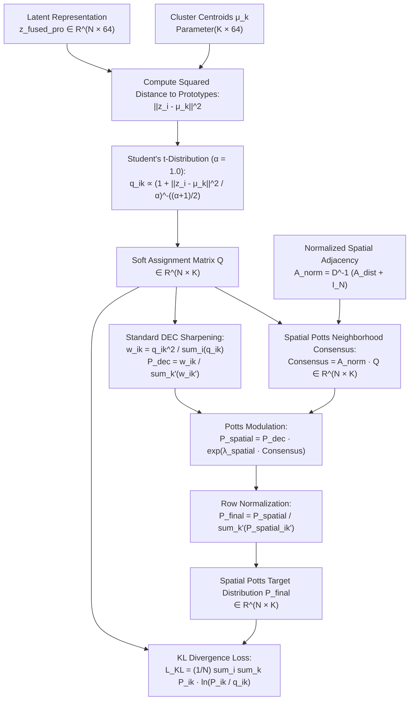
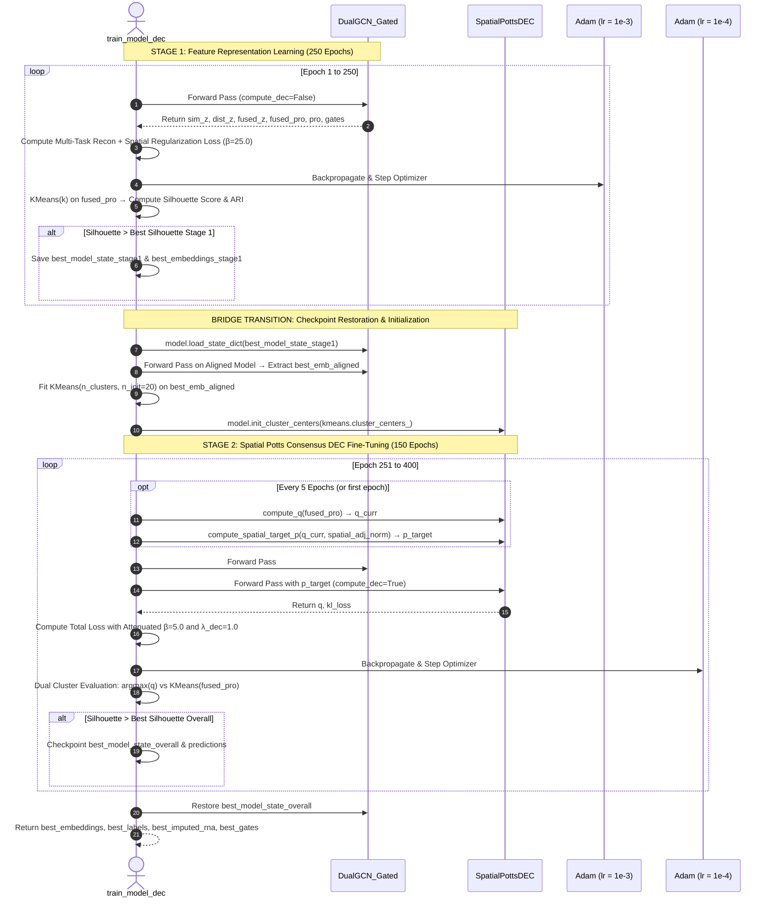

# ASTRA-Redo: Comprehensive Architectural & Technical Reference Guide

A rigorous, exhaustive guide to the **ASTRA-Redo** (`astra-redo.py`) multi-omics spatial clustering framework. This document details the mathematical theory, graph topological formulations, neural architectures, training dynamics, loss functions, codebase structure, and visual diagnostic engines.

---

## Table of Contents

1. [Executive Summary & Problem Formulation](#1-executive-summary--problem-formulation)
2. [End-to-End System Pipeline & Architecture](#2-end-to-end-system-pipeline--architecture)
3. [Dual-Graph Topology & Spatial Adjacency](#3-dual-graph-topology--spatial-adjacency)
4. [Universal Multi-Omics Preprocessing Engine](#4-universal-multi-omics-preprocessing-engine)
5. [Neural Backbone & Deep Network Architectures](#5-neural-backbone--deep-network-architectures)
   - [Spot-Adaptive Gated Attention Fusion (`GatedAttentionFusion`)](#spot-adaptive-gated-attention-fusion-gatedattentionfusion)
   - [Spatial Potts MRF Deep Embedding Clustering (`SpatialPottsDEC`)](#spatial-potts-mrf-deep-embedding-clustering-spatialpottsdec)
   - [Dual-Branch GCN Backbone (`DualGCN_Gated`)](#dual-branch-gcn-backbone-dualgcn_gated)
   - [Unified Model Wrapper (`ASTRA_v1_DEC_Gated`)](#unified-model-wrapper-astra_v1_dec_gated)
6. [Mathematical Loss Formulations](#6-mathematical-loss-formulations)
7. [Two-Stage Optimization & Checkpoint Restoration Bridge](#7-two-stage-optimization--checkpoint-restoration-bridge)
8. [Codebase Map & Module Reference](#8-codebase-map--module-reference)
9. [Dataset Integration & Automatic Download Manager](#9-dataset-integration--automatic-download-manager)
10. [Visual Diagnostics & Publication Plotting](#10-visual-diagnostics--publication-plotting)
11. [Command-Line Interface (CLI) Execution Guide](#11-command-line-interface-cli-execution-guide)

---

## 1. Executive Summary & Problem Formulation

Spatial multi-omics technologies (such as 10x Genomics Visium paired with CITE-seq ADT antibodies or spatial ATAC-seq chromatin accessibility profiling) allow simultaneous measurement of physical tissue coordinates, transcriptomic gene expression, and auxiliary epigenomic or proteomic profiles.

### Core Challenges

1. **Extreme Sparsity & High Dimensionality**: Single-cell and spatial RNA profiles exhibit technical dropouts and high Poisson/negative binomial noise across 20,000+ genes.
2. **Modality Scale & Distribution Mismatch**: RNA-seq consists of count data with overdispersion; ADT (antibody-derived tags) captures continuous protein binding with non-specific background; ATAC-seq contains sparse binary chromatin accessibility peaks.
3. **Spatial "Salt-and-Pepper" Noise**: Standard clustering models operate in feature space independently per spot, producing scattered, biologically implausible assignments that violate spatial tissue coherence.
4. **Modality Dominance & Representation Collapse**: Concatenating modalities naively often leads to one modality (typically high-variance RNA) overpowering the other, rendering auxiliary modalities ineffective.

### The ASTRA-Redo Solution

[astra-redo.py](file:///d:/FYDP/GATCON/d1_test/astra-redo.py) resolves these challenges through five core innovations:

```
+---------------------------------------------------------------------------------------------------+
|                                      ASTRA-Redo CORE INNOVATIONS                                  |
+----------------------------------+----------------------------------+-----------------------------+
| 1. Dual-Graph Topology           | 2. Two-Tier Gated Attention      | 3. Decoupled Multi-Task     |
| - Cosine RNA similarity graph    | - Tier 1: Sim vs Dist RNA fusion |    Reconstruction           |
| - Physical 2D distance graph     | - Tier 2: RNA vs ADT/ATAC fusion | - Joint raw reconstruction  |
| - Consensus intersection graph   | - Per-spot, per-channel weights  | - Separate branch decoders  |
+----------------------------------+----------------------------------+-----------------------------+
| 4. Spatial Potts MRF DEC         | 5. Two-Stage Bridge Transition   |                             |
| - Student's t soft clustering    | - Stage 1: Pure representations  |                             |
| - Exponential Potts neighborhood | - Bridge: Peak weight restore    |                             |
|   consensus modulation           | - Stage 2: DEC with attenuated β |                             |
+----------------------------------+----------------------------------+-----------------------------+
```

---

## 2. End-to-End System Pipeline & Architecture

The following diagram illustrates the complete tensor flow through [astra-redo.py](file:///d:/FYDP/GATCON/d1_test/astra-redo.py):



### Tensor Dimensionality Tracking

| Tensor Identifier | Variable in Code | Shape / Format | Semantic Description |
| :--- | :--- | :--- | :--- |
| $X_{\text{RNA}}$ | `data.x_RNA` | $(N, 3000)$ | Preprocessed, scaled RNA highly variable gene counts |
| $X_{\text{ADT}} / X_{\text{ATAC}}$ | `data.x_ADT` | $(N, D_{\text{aux}})$ | Preprocessed auxiliary modality ($D_{\text{aux}}=D_{\text{protein}}$ or $50$ for ATAC) |
| $P$ | `cell_positions` | $(N, 2)$ | True physical 2D Cartesian coordinates $(x, y)$ |
| $\mathcal{E}_{\text{sim}}$ | `data.sim_edge_index` | $(2, |\mathcal{E}_{\text{sim}}|)$ | Directed coordinate edge pairs for RNA cosine kNN graph |
| $W_{\text{sim}}$ | `data.sim_edge_weight` | $(|\mathcal{E}_{\text{sim}}|)$ | Pairwise cosine similarity edge weights |
| $\mathcal{E}_{\text{dist}}$ | `data.dist_edge_index` | $(2, |\mathcal{E}_{\text{dist}}|)$ | Spatial Euclidean neighbor edge pairs |
| $W_{\text{dist}}$ | `data.dist_edge_weight` | $(|\mathcal{E}_{\text{dist}}|)$ | Euclidean distance edge weights |
| $\mathcal{E}_{\text{common}}$ | `data.common_edge_index` | $(2, |\mathcal{E}_{\text{common}}|)$ | Intersection consensus edges ($\mathcal{E}_{\text{sim}} \cap \mathcal{E}_{\text{dist}}$) |
| $A_{\text{norm}}$ | `spatial_adj_norm` | $(N, N)$ dense | Row-normalized Potts spatial transition matrix |
| $z_{\text{sim}}$ | `x_sim` | $(N, 64)$ | RNA representations guided by transcriptomic cosine graph |
| $z_{\text{dist}}$ | `x_dist` | $(N, 64)$ | RNA representations guided by spatial Euclidean graph |
| $z_{\text{pro}}$ | `pro` | $(N, 64)$ | Auxiliary representations guided by consensus graph |
| $g_{\text{sp}}$ | `gate_spatial` | $(N, 64)$ | Intra-RNA spot-adaptive gating coefficients $\in (0, 1)$ |
| $z_{\text{fused}}$ | `fused` | $(N, 64)$ | Fused RNA representation ($g_{\text{sp}} \odot z_{\text{sim}} + (1 - g_{\text{sp}}) \odot z_{\text{dist}}$) |
| $g_{\text{mod}}$ | `gate_modality` | $(N, 64)$ | Cross-modality spot-adaptive gating coefficients $\in (0, 1)$ |
| $z_{\text{fused\_pro}}$ | `fused_pro` | $(N, 64)$ | Final unified multi-omics joint latent embedding |
| $Q$ | `q` | $(N, K)$ | Student's t-distribution soft cluster assignments |
| $P$ | `p_target` | $(N, K)$ | Potts-consensus sharpened target distribution |
| $\hat{X}_{\text{joint}}$ | `reconstruct_joint` | $(N, 3000 + D_{\text{aux}})$ | Decoded raw multi-omics joint reconstruction |

---

## 3. Dual-Graph Topology & Spatial Adjacency

Implemented in [lines 127–186 of astra-redo.py](file:///d:/FYDP/GATCON/d1_test/astra-redo.py#L127-L186). ASTRA-Redo defines three explicit topological graphs and one spatial Markov transition matrix.



### Mathematical Definitions

#### 1. Transcriptomic Feature Similarity Graph ($G_{\text{sim}}$)
Given the scaled RNA matrix $X_{\text{RNA}} \in \mathbb{R}^{N \times G}$:
$$S_{ij}^{\cos} = \frac{X_{\text{RNA}, i} \cdot X_{\text{RNA}, j}}{\|X_{\text{RNA}, i}\|_2 \|X_{\text{RNA}, j}\|_2 + 10^{-12}}$$
Let $\mathcal{N}_k^{\cos}(i)$ denote the $k$-nearest neighbors of spot $i$ under cosine distance ($k=15$). The binary adjacency matrix is symmetrized via:
$$A_{ij}^{\text{sim}} = \begin{cases} 1 & \text{if } j \in \mathcal{N}_k^{\cos}(i) \lor i \in \mathcal{N}_k^{\cos}(j) \\ 0 & \text{otherwise} \end{cases}$$
The final edge weights are assigned the true pairwise cosine similarities:
$$W_{ij}^{\text{sim}} = S_{ij}^{\cos} \quad \forall (i, j) \text{ such that } A_{ij}^{\text{sim}} = 1$$

#### 2. Spatial Coordinate Distance Graph ($G_{\text{dist}}$)
Given spatial physical coordinates $P \in \mathbb{R}^{N \times 2}$ where $p_i = (x_i, y_i)$:
$$d_{ij} = \|p_i - p_j\|_2 = \sqrt{(x_i - x_j)^2 + (y_i - y_j)^2}$$
Using Euclidean $k$-nearest neighbors ($k=15$, excluding self):
$$A_{\text{dist}} = \max(A_{\text{knn}}, A_{\text{knn}}^T)$$
$$W_{ij}^{\text{dist}} = d_{ij} \quad \forall (i, j) \in \mathcal{E}_{\text{dist}}$$

#### 3. Common Edge Pure Intersection Consensus Graph ($G_{\text{common}}$)
The auxiliary omics channel propagates information exclusively across connections that exist simultaneously in physical space and expression space:
$$\mathcal{E}_{\text{common}} = \mathcal{E}_{\text{sim}} \cap \mathcal{E}_{\text{dist}}$$
$$W_{ij}^{\text{common}} = 1.0 \quad \forall (i, j) \in \mathcal{E}_{\text{common}}$$

> [!IMPORTANT]
> **Biological Justification for $G_{\text{common}}$**: Auxiliary omics data (e.g., cell-surface antibodies or chromatin accessibility) can suffer from non-specific background binding or chromatin accessibility dropouts. By restricting message passing to $\mathcal{E}_{\text{common}}$, the auxiliary GCN is prevented from propagating spurious noise between cells that share marker similarity but reside in distinct anatomical structures.

#### 4. Row-Normalized Spatial Potts Operator ($A_{\text{norm}}$)
Used by the Potts Markov Random Field consensus clustering:
$$\tilde{A}_{\text{dist}} = A_{\text{dist}} + I_N$$
$$D_{ii} = \sum_{j=1}^N (\tilde{A}_{\text{dist}})_{ij}$$
$$A_{\text{norm}} = D^{-1} \tilde{A}_{\text{dist}}$$
where $(A_{\text{norm}})_{ij} \ge 0$ and $\sum_{j=1}^N (A_{\text{norm}})_{ij} = 1$ for all spots $i$.

---

## 4. Universal Multi-Omics Preprocessing Engine

Implemented in [lines 69–126 of astra-redo.py](file:///d:/FYDP/GATCON/d1_test/astra-redo.py#L69-L126). The preprocessing engine accepts heterogeneous multi-omics inputs and applies domain-specific transformations.



### Preprocessing Formulations

#### 1. Transcriptomic Normalization (RNA)
For raw count matrix $C \in \mathbb{N}^{N \times M}$:
1. Filter out genes detected in fewer than 10 spots.
2. Select 3,000 Highly Variable Genes (HVGs) using the Seurat v3 variance-stabilizing transformation:
   $$\text{Var}_{\text{adj}}(g) = \frac{\sigma_g^2 - \hat{\mu}_g}{\hat{\mu}_g^2}$$
3. Library-size normalization to target sum $10^4$:
   $$x_{ij}' = \ln\left(1 + \frac{x_{ij}}{\sum_{k=1}^G x_{ik}} \times 10^4\right)$$
4. Z-score scaling:
   $$z_{ij} = \frac{x_{ij}' - \mu_j}{\sigma_j}$$

#### 2. Antibody-Derived Tag (ADT) Centered Log Ratio (CLR)
Implemented in `clr_normalize_each_cell` ([lines 70–81](file:///d:/FYDP/GATCON/d1_test/astra-redo.py#L70-L81)):
$$\mu_{\ln}(x_i) = \frac{1}{|x_i|} \sum_{j: x_{ij} > 0} \ln(1 + x_{ij})$$
$$G(x_i) = \exp(\mu_{\ln}(x_i))$$
$$\text{seurat\_clr}(x_{ij}) = \ln\left(1 + \frac{x_{ij}}{G(x_i) + 10^{-12}}\right)$$
Following CLR transformation, features are standardized across spots via `sc.pp.scale(adata_omics2)`.

#### 3. Spatial ATAC-seq Epigenomic Peak Normalization (TF-IDF + PCA)
Implemented in `tfidf` ([lines 83–90](file:///d:/FYDP/GATCON/d1_test/astra-redo.py#L83-L90)):
$$\text{TF}_{ij} = \frac{X_{ij}}{\sum_{k=1}^{M_{\text{peaks}}} X_{ik} + 10^{-12}}$$
$$\text{IDF}_j = \frac{N}{\sum_{i=1}^N X_{ij} + 10^{-12}}$$
$$\text{TF-IDF}(X)_{ij} = \text{TF}_{ij} \cdot \text{IDF}_j$$
After TF-IDF, cells are normalized to $10^4$ total counts, log-transformed with $\ln(1+x)$, and compressed to 50 dimensions using Principal Component Analysis:
$$Z_{\text{ATAC}} = \text{PCA}_{50}\left(\ln(1 + \text{Norm}(\text{TF-IDF}(X)))\right) \in \mathbb{R}^{N \times 50}$$

---

## 5. Neural Backbone & Deep Network Architectures

Implemented in [lines 187–378 of astra-redo.py](file:///d:/FYDP/GATCON/d1_test/astra-redo.py#L187-L378).

### Spot-Adaptive Gated Attention Fusion (`GatedAttentionFusion`)

Implemented in [lines 188–209](file:///d:/FYDP/GATCON/d1_test/astra-redo.py#L188-L209). Standard multimodal fusion schemes rely on static concatenation or scalar global weights. ASTRA-Redo introduces dynamic, per-spot, per-channel gating:



#### Formulation:
Given two latent representations $z_1, z_2 \in \mathbb{R}^{N \times d}$:
$$g = \sigma\left(W_g [z_1 \parallel z_2] + b_g\right) \in (0, 1)^{N \times d}$$
$$z_{\text{fused}} = W_o \left(g \odot z_1 + (\mathbf{1} - g) \odot z_2\right) + b_o \in \mathbb{R}^{N \times d}$$
where $\odot$ denotes the Hadamard (element-wise) product, $\sigma(x) = \frac{1}{1 + e^{-x}}$, and $W_o \in \mathbb{R}^{d \times d}$.

ASTRA-Redo stacks two consecutive instances of this module:
1. **Tier 1 (Within-Modality)**: `fusion_layer1` fuses transcriptomic similarity $z_{\text{sim}}$ with spatial coordinate embedding $z_{\text{dist}}$:
   $$z_{\text{fused}}, g_{\text{spatial}} = \text{FusionLayer}_1(z_{\text{sim}}, z_{\text{dist}})$$
2. **Tier 2 (Cross-Modality)**: `fusion_layer2` fuses the spatial-transcriptomic manifold $z_{\text{fused}}$ with auxiliary proteomic/epigenomic embedding $z_{\text{pro}}$:
   $$z_{\text{fused\_pro}}, g_{\text{modality}} = \text{FusionLayer}_2(z_{\text{fused}}, z_{\text{pro}})$$

---

### Spatial Potts MRF Deep Embedding Clustering (`SpatialPottsDEC`)

Implemented in [lines 211–254](file:///d:/FYDP/GATCON/d1_test/astra-redo.py#L211-L254). Standard DEC sharpens cluster probabilities using a Student's t-distribution kernel, but operates purely in latent feature space, ignoring spatial proximity. ASTRA-Redo introduces a spatial Potts Markov Random Field consensus mechanism that injects neighborhood affinity into the target distribution $P$:



#### Mathematical Steps:

1. **Soft Assignment Matrix $Q$**:
   Using Student's t-distribution with degree of freedom $\alpha=1.0$:
   $$q_{ik} = \frac{\left(1 + \frac{\|z_i - \mu_k\|_2^2}{\alpha}\right)^{-\frac{\alpha + 1}{2}}}{\sum_{k'=1}^K \left(1 + \frac{\|z_i - \mu_{k'}\|_2^2}{\alpha}\right)^{-\frac{\alpha + 1}{2}}}$$
   where $\mu_k \in \mathbb{R}^{64}$ ($k=1, \dots, K$) are learnable cluster prototype centroids.

2. **Standard DEC Target Sharpening ($P_{\text{dec}}$)**:
   Squares probabilities and normalizes by cluster frequencies to emphasize confident predictions:
   $$p_{\text{dec}, ik} = \frac{q_{ik}^2 / \sum_{i=1}^N q_{ik}}{\sum_{k'=1}^K \left(q_{ik'}^2 / \sum_{i=1}^N q_{ik'}\right)}$$

3. **Potts Spatial Consensus Modulation ($P_{\text{final}}$)**:
   Computes local neighborhood cluster consensus via matrix multiplication:
   $$\text{Consensus}_{ik} = \sum_{j=1}^N (A_{\text{norm}})_{ij} q_{jk} = (A_{\text{norm}} Q)_{ik}$$
   Modulates the sharpened DEC probabilities by exponential Potts neighborhood energy:
   $$p_{\text{spatial}, ik} = p_{\text{dec}, ik} \cdot \exp\left(\lambda_{\text{spatial}} \cdot \text{Consensus}_{ik}\right)$$
   where $\lambda_{\text{spatial}} = 0.15$. Row-normalizing yields the final target distribution:
   $$p_{\text{final}, ik} = \frac{p_{\text{spatial}, ik}}{\sum_{k'=1}^K p_{\text{spatial}, ik'} + 10^{-12}}$$

4. **Kullback-Leibler (KL) Divergence Objective**:
   $$\mathcal{L}_{\text{KL}} = \text{KL}(Q \parallel P_{\text{final}}) = \frac{1}{N} \sum_{i=1}^N \sum_{k=1}^K p_{\text{final}, ik} \ln\left(\frac{p_{\text{final}, ik}}{q_{ik} + 10^{-12}}\right)$$

---

### Dual-Branch GCN Backbone (`DualGCN_Gated`)

Implemented in [lines 255–304](file:///d:/FYDP/GATCON/d1_test/astra-redo.py#L255-L304). The network features three parallel graph convolution streams:

```
  x_RNA (3000) ──► GCNConv(3000→512) ──► ReLU ──► GCNConv(512→64) ──► z_sim (64)
                   [Over G_sim]                   [Over G_sim]

  x_RNA (3000) ──► GCNConv(3000→512) ──► ReLU ──► GCNConv(512→64) ──► z_dist (64)
                   [Over G_dist]                  [Over G_dist]

  x_ADT (q_dim) ──► GCNConv(q_dim→64) ────────────────────────────────► z_pro (64)
                   [Over G_common]
```

### Decoupled Multi-Task Decoders

To prevent feature collapse and ensure each individual branch retains biological fidelity, the model employs 4 specialized reconstruction heads:

| Decoder Method | Input Latent Vector | Output Target | Layer Architecture |
| :--- | :--- | :--- | :--- |
| `reconstruct_joint(z)` | $z_{\text{fused\_pro}} \in \mathbb{R}^{64}$ | Combined $[X_{\text{RNA}} \parallel X_{\text{ADT}}] \in \mathbb{R}^{3000 + q_{\text{dim}}}$ | $\text{Linear}(64 \to 512) \to \text{ReLU} \to \text{Linear}(512 \to 3000 + q_{\text{dim}})$ |
| `reconstruct_rna(z)` | $z_{\text{sim}} \in \mathbb{R}^{64}$ | RNA features $X_{\text{RNA}} \in \mathbb{R}^{3000}$ | $\text{Linear}(64 \to 512) \to \text{ReLU} \to \text{Linear}(512 \to 3000)$ |
| `reconstruct_rna(z)` | $z_{\text{dist}} \in \mathbb{R}^{64}$ | RNA features $X_{\text{RNA}} \in \mathbb{R}^{3000}$ | $\text{Linear}(64 \to 512) \to \text{ReLU} \to \text{Linear}(512 \to 3000)$ |
| `reconstruct_aux(z)` | $z_{\text{pro}} \in \mathbb{R}^{64}$ | Auxiliary features $X_{\text{ADT}} \in \mathbb{R}^{q_{\text{dim}}}$ | $\text{Linear}(64 \to 512) \to \text{ReLU} \to \text{Linear}(512 \to q_{\text{dim}})$ |

---

## 6. Mathematical Loss Formulations

Implemented in [lines 342–378 of astra-redo.py](file:///d:/FYDP/GATCON/d1_test/astra-redo.py#L342-L378). The total training loss balances reconstruction fidelity, spatial neighborhood preservation, weight sparsity, and clustering entropy.

### 1. Multi-Task Reconstruction Losses

$$\mathcal{L}_{\text{rec}} = \frac{1}{N} \sum_{i=1}^N \left\| [X_{\text{RNA}} \parallel X_{\text{ADT}}]_i - \text{Dec}_{\text{joint}}(z_{\text{fused\_pro}, i}) \right\|_2^2$$
$$\mathcal{L}_{\text{sim}} = \frac{1}{N} \sum_{i=1}^N \left\| X_{\text{RNA}, i} - \text{Dec}_{\text{rna}}(z_{\text{sim}, i}) \right\|_2^2$$
$$\mathcal{L}_{\text{dist}} = \frac{1}{N} \sum_{i=1}^N \left\| X_{\text{RNA}, i} - \text{Dec}_{\text{rna}}(z_{\text{dist}, i}) \right\|_2^2$$
$$\mathcal{L}_{\text{aux}} = \frac{1}{N} \sum_{i=1}^N \left\| X_{\text{ADT}, i} - \text{Dec}_{\text{aux}}(z_{\text{pro}, i}) \right\|_2^2$$

### 2. Spatial Regularization Contrastive Loss (`spatial_regularization_loss`)

Computes a graph contrastive objective on the fused RNA embedding $z_{\text{fused}}$ against the spatial neighborhood graph:
$$S_{ij} = \frac{z_{\text{fused}, i} \cdot z_{\text{fused}, j}}{\|z_{\text{fused}, i}\|_2 \|z_{\text{fused}, j}\|_2 + 10^{-12}} \quad (i \neq j, \quad S_{ii} = 0)$$
$$\tilde{S}_{ij} = \sigma(S_{ij}) = \frac{1}{1 + e^{-S_{ij}}}$$
Given binary spatial adjacency matrix $A_{\text{spatial}} \in \{0, 1\}^{N \times N}$:
$$\mathcal{L}_{\text{spatial}} = -\frac{1}{2} \left[ \frac{1}{N^2} \sum_{i=1}^N \sum_{j=1}^N A_{ij}^{\text{spatial}} \ln(\tilde{S}_{ij} + 10^{-10}) + \frac{1}{N^2} \sum_{i=1}^N \sum_{j=1}^N (1 - A_{ij}^{\text{spatial}}) \ln(1 - \tilde{S}_{ij} + 10^{-10}) \right]$$

### 3. Weight Regularization

$$\mathcal{L}_{\text{reg}} = \lambda_{L_1} \sum_{\theta \in \Theta} |\theta| + \lambda_{L_2} \sum_{\theta \in \Theta} \theta^2$$
where $\lambda_{L_1} = 10^{-4}$ and $\lambda_{L_2} = 10^{-3}$.

### 4. Master Loss Objective & Stage-Specific Dynamic Weighting

$$\mathcal{L}_{\text{total}} = \beta_{\text{curr}} \left(\mathcal{L}_{\text{rec}} + \mathcal{L}_{\text{sim}} + \mathcal{L}_{\text{dist}} + \mathcal{L}_{\text{aux}}\right) + \gamma \mathcal{L}_{\text{spatial}} + \delta \mathcal{L}_{\text{reg}} + \mathbb{I}(\text{Stage 2}) \cdot \lambda_{\text{dec}} \mathcal{L}_{\text{KL}}$$

#### Dynamic Hyperparameter Scaling:

$$\beta_{\text{curr}} = \begin{cases} \beta = 25.0 & \text{Stage 1 (Pre-training, epochs 1–250)} \\ 0.2 \times \beta = 5.0 & \text{Stage 2 (DEC fine-tuning, epochs 251–400)} \end{cases}$$

> [!NOTE]
> **Why Attenuate $\beta$ in Stage 2?**
> If $\beta$ remains at $25.0$, reconstruction loss gradients overpower the DEC clustering loss $\mathcal{L}_{\text{KL}}$. Reducing $\beta$ to $5.0$ allows the Potts MRF clustering objective to actively shape and sharpen cluster boundaries in latent space.

---

## 7. Two-Stage Optimization & Checkpoint Restoration Bridge

Implemented in [lines 422–638 of astra-redo.py](file:///d:/FYDP/GATCON/d1_test/astra-redo.py#L422-L638) (`train_model_dec`).



### Key Mechanisms:

1. **Peak Checkpoint Restoration Bridge**: Rather than using epoch 250 directly (which may have degraded), ASTRA-Redo restores `best_model_state_stage1` (the epoch with highest Silhouette score in Stage 1) before initializing DEC cluster centroids.
2. **Dual-Clustering Selection in Stage 2**: Evaluates both the argmax of DEC soft assignments $q$ and a fresh KMeans clustering on the latent embedding $z_{\text{fused\_pro}}$, selecting whichever yields the higher Silhouette score.
3. **Decoupled Learning Rates**: Stage 1 uses $\eta_1 = 10^{-3}$; Stage 2 decelerates to $\eta_2 = 10^{-4}$ ($10\times$ smaller) to avoid disrupting the learned representations.

---

## 8. Codebase Map & Module Reference

Every major class, function, and block in [astra-redo.py](file:///d:/FYDP/GATCON/d1_test/astra-redo.py) is cataloged below with direct links:

```
astra-redo.py
├── Lines 1-68: Environment & Determinism
│   ├── set_seed(seed=42)                       [L47-L58]
│   └── init_r_mclust()                         [L60-L68]
│
├── Lines 69-126: Universal Preprocessing Engine
│   ├── clr_normalize_each_cell(adata)          [L70-L81]
│   │   └── seurat_clr(x)                       [L71-L74]
│   ├── tfidf(X)                                [L83-L90]
│   └── preprocess_universal(...)              [L92-L126]
│
├── Lines 127-186: Dual-Graph Topology & Adjacency
│   ├── DualGraphData (torch_geometric.data)    [L128-L140]
│   ├── build_dual_graph(...)                   [L141-L178]
│   └── compute_spatial_adj_norm(...)           [L180-L186]
│
├── Lines 187-378: Neural Architecture Modules
│   ├── GatedAttentionFusion (nn.Module)        [L188-L209]
│   ├── SpatialPottsDEC (nn.Module)             [L211-L254]
│   │   ├── compute_q(z)                        [L226-L232]
│   │   └── compute_spatial_target_p(q, adj)    [L234-L245]
│   ├── DualGCN_Gated (nn.Module)               [L255-L304]
│   │   ├── forward(...)                        [L279-L294]
│   │   ├── reconstruct_joint(z)                [L296-L297]
│   │   ├── reconstruct_rna(z)                  [L299-L300]
│   │   └── reconstruct_aux(z)                  [L302-L303]
│   └── ASTRA_v1_DEC_Gated (nn.Module)          [L305-L378]
│       ├── init_cluster_centers(...)           [L318-L320]
│       ├── spatial_regularization_loss(...)    [L342-L353]
│       └── compute_losses(...)                 [L355-L378]
│
├── Lines 379-638: Clustering & Optimization Engine
│   ├── mclust_R(...)                           [L380-L414]
│   ├── cluster_embeddings(...)                 [L416-L420]
│   └── train_model_dec(...)                    [L422-L638]
│
├── Lines 640-684: Dataset Resolver & Download
│   ├── CHOICES (catalog)                       [L641-L648]
│   └── resolve_dataset_files(...)              [L650-L684]
│
├── Lines 688-816: Visualization Engines
│   ├── plot_training_curves(...)               [L692-L740]
│   └── plot_all_visualizations(...)            [L741-L815]
│
└── Lines 817-930: CLI Orchestration & Main Entry
    ├── run_experiment(...)                     [L821-L904]
    └── if __name__ == '__main__':              [L906-L930]
```

### Module Descriptions

- [`set_seed`](file:///d:/FYDP/GATCON/d1_test/astra-redo.py#L47-L58): Sets seeds across `random`, `numpy`, `torch` (CPU + CUDA), configures cuDNN determinism, and locks `PYTHONHASHSEED`.
- [`preprocess_universal`](file:///d:/FYDP/GATCON/d1_test/astra-redo.py#L92-L126): Automatically detects dataset type (`10x_*` vs `Mouse_Brain_*`), applying Seurat CLR for ADT or TF-IDF + PCA for ATAC.
- [`build_dual_graph`](file:///d:/FYDP/GATCON/d1_test/astra-redo.py#L141-L178): Constructs $G_{\text{sim}}$, $G_{\text{dist}}$, and $G_{\text{common}}$ PyTorch Geometric tensors.
- [`compute_spatial_adj_norm`](file:///d:/FYDP/GATCON/d1_test/astra-redo.py#L180-L186): Builds the row-normalized Potts spatial transition matrix with self-loops.
- [`GatedAttentionFusion`](file:///d:/FYDP/GATCON/d1_test/astra-redo.py#L188-L209): Learns element-wise gating vectors $g \in (0, 1)^d$ to combine two latent streams.
- [`SpatialPottsDEC`](file:///d:/FYDP/GATCON/d1_test/astra-redo.py#L211-L254): Implements Student's t soft clustering and spatial Potts MRF consensus target distribution calculation.
- [`train_model_dec`](file:///d:/FYDP/GATCON/d1_test/astra-redo.py#L422-L638): Manages the full 400-epoch two-stage optimization cycle, checkpoint restoration, and dual evaluation.
- [`plot_all_visualizations`](file:///d:/FYDP/GATCON/d1_test/astra-redo.py#L741-L815): Generates publication-ready training curves, spatial domain scatter plots, UMAP embeddings, and silhouette violin plots.

---

## 9. Dataset Integration & Automatic Download Manager

Implemented in [lines 640–684 of astra-redo.py](file:///d:/FYDP/GATCON/d1_test/astra-redo.py#L640-L684). The model includes built-in download resolution for 6 spatial multi-omics benchmarks:

| Index | Dataset Name | Modalities | Organism / Tissue | Annotation Column |
| :---: | :--- | :--- | :--- | :--- |
| `0` | `10x_human_lymph_node_A1` | Spatial RNA + ADT | Human Lymph Node | `manual-anno` |
| `1` | `10x_human_lymph_node_D1` | Spatial RNA + ADT | Human Lymph Node | `manual-anno` |
| `2` | `Mouse_Brain_E11_S1` | Spatial RNA + ATAC | Mouse Embryo Brain (E11) | `cluster` |
| `3` | `Mouse_Brain_E13_S1` | Spatial RNA + ATAC | Mouse Embryo Brain (E13) | `cluster` |
| `4` | `Mouse_Brain_E15_S1` | Spatial RNA + ATAC | Mouse Embryo Brain (E15) | `cluster` |
| `5` | `Mouse_Brain_E18_S1` | Spatial RNA + ATAC | Mouse Embryo Brain (E18) | `cluster` |

### Resolution Hierarchy:
`resolve_dataset_files` searches candidate local directories in order:
1. `data/{dataset_name}`
2. `/content/data/{dataset_name}`
3. `/content/drive/MyDrive/Colab/data/{dataset_name}`
4. `/content/drive/MyDrive/Colab/ARISE/data/{dataset_name}`
5. `/content/drive/MyDrive/Colab/{dataset_name}`

If missing, it automatically invokes `gdown --folder` using the preconfigured Google Drive folder URL.

---

## 10. Visual Diagnostics & Publication Plotting

Implemented in [lines 688–816 of astra-redo.py](file:///d:/FYDP/GATCON/d1_test/astra-redo.py#L688-L816). When `visualize=True`, four distinct figure types are exported to `output_dir/plots/`:

```
output_dir/plots/
├── curves/
│   └── {dataset}_seed{seed}_training_curves.png
│       ├── Panel 1: Loss curves (Total, Recon, Spatial, KL, L_sim, L_dist, L_aux)
│       ├── Panel 2: Silhouette Score progression over all 400 epochs
│       └── Panel 3: Adjusted Rand Index (ARI) progression over all 400 epochs
│
├── spatial/
│   └── {dataset}_seed{seed}_spatial.png
│       ├── Panel 1: Ground truth biological domains mapped on physical (x, y) coordinates
│       └── Panel 2: ASTRA-Redo predicted spatial domains with ARI annotation
│
├── umap/
│   └── {dataset}_seed{seed}_umap.png
│       ├── Panel 1: 2D UMAP projection colored by Ground Truth labels
│       └── Panel 2: 2D UMAP projection colored by ASTRA-Redo predicted clusters
│
└── violin/
    └── {dataset}_seed{seed}_violin.png
        ├── Panel 1: Silhouette coefficient distributions across predicted domains
        └── Panel 2: Latent dimension 1 distributions across domains
```

---

## 11. Command-Line Interface (CLI) Execution Guide

Implemented in [lines 906–930 of astra-redo.py](file:///d:/FYDP/GATCON/d1_test/astra-redo.py#L906-L930).

### CLI Arguments

| Flag | Type | Default | Description |
| :--- | :---: | :---: | :--- |
| `--datasets` | `str` (list) | `['all']` | Datasets to evaluate (names or indices `0` to `5`, or `'all'`) |
| `--seeds` | `int` (list) | `[42, 1234, 2024]` | Pseudo-random seeds for statistical validation |
| `--pretrain_epochs`| `int` | `250` | Stage 1 representation learning epochs |
| `--finetune_epochs`| `int` | `150` | Stage 2 Spatial Potts DEC fine-tuning epochs |
| `--lr` | `float` | `1e-3` | Base Adam learning rate (Stage 2 automatically uses $\text{lr} \times 0.1$) |
| `--lambda_dec` | `float` | `1.0` | KL divergence loss weight during Stage 2 |
| `--lambda_spatial`| `float` | `0.15` | Spatial Potts MRF neighborhood consensus coefficient |
| `--output_dir` | `str` | `'astra_redo_Results'` | Directory where plots and CSV results are saved |
| `--visualize` | `bool` | `True` | Whether to generate and save publication figures |

### Example Commands

#### Run on a Single Dataset (Human Lymph Node D1):
```bash
python astra-redo.py --datasets 10x_human_lymph_node_D1 --seeds 42 --output_dir results/lymph_node_D1
```

#### Run Using Dataset Index:
```bash
python astra-redo.py --datasets 1 --seeds 42 1234 --output_dir results/d1_experiment
```

#### Full Benchmark Sweep Across All 6 Datasets:
```bash
python astra-redo.py --datasets all --seeds 42 1234 2024 --output_dir astra_redo_Results
```

#### Custom Hyperparameters:
```bash
python astra-redo.py --datasets 0 --pretrain_epochs 300 --finetune_epochs 200 --lambda_spatial 0.20 --lr 0.0005
```

---

## Summary of Key Differences from Baseline

| Architectural Feature | Baseline ASTRA / GCN | ASTRA-Redo |
| :--- | :--- | :--- |
| **Multimodal Fusion** | Concatenation or static linear projection | Two-tier spot-adaptive dynamic gating ($g \in (0, 1)^d$) |
| **Graph Topology** | Single shared spatial or cosine graph | Dual-graph ($G_{\text{sim}}, G_{\text{dist}}$) + consensus intersection ($G_{\text{common}}$) |
| **Decoders** | Single joint decoder | Decoupled multi-task decoders (joint, sim RNA, dist RNA, aux) |
| **Clustering Target** | Standard DEC Student's t | Spatial Potts MRF consensus ($P_{\text{final}} \propto P_{\text{dec}} \cdot e^{\lambda \cdot A_{\text{norm}} Q}$) |
| **Optimization** | Single-phase or direct handoff | Checkpoint restoration bridge + attenuated reconstruction $\beta$ ($25.0 \to 5.0$) |

