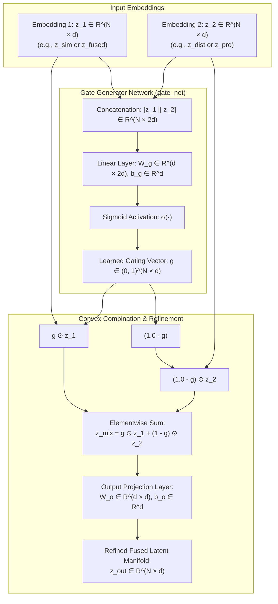
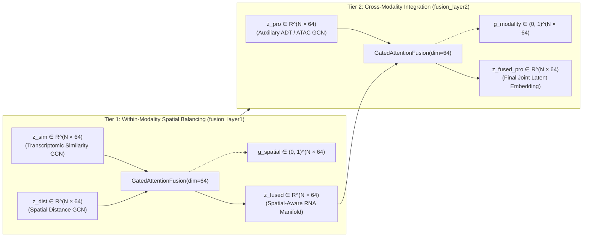
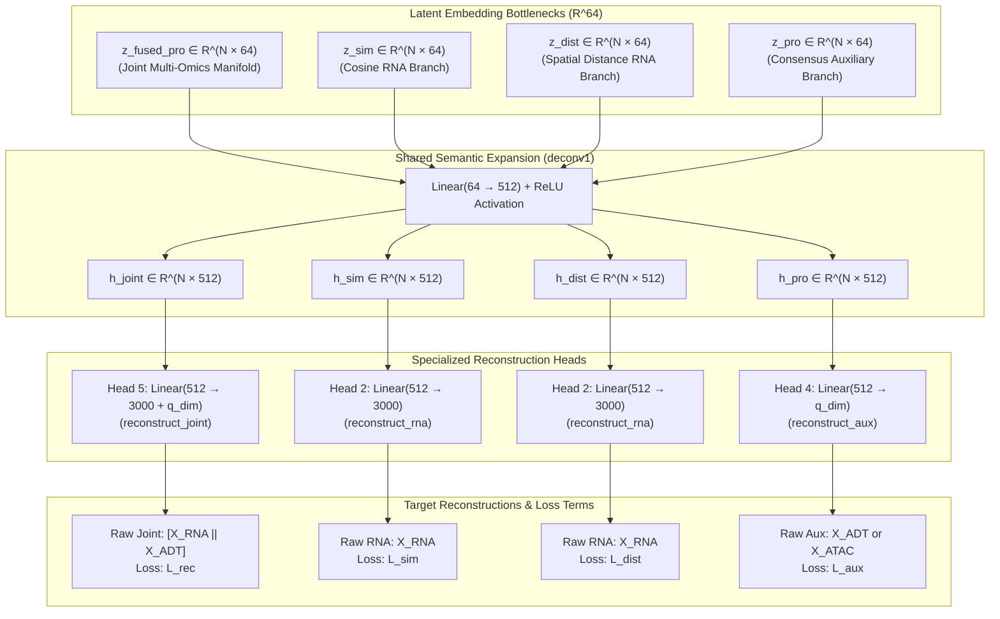
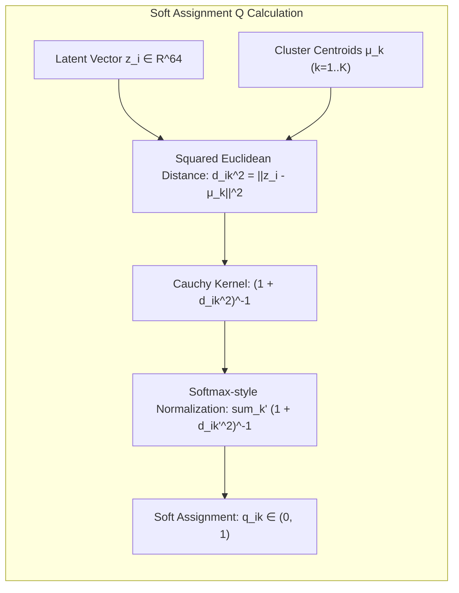
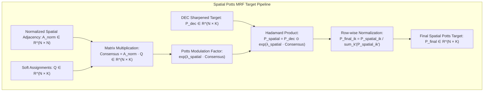
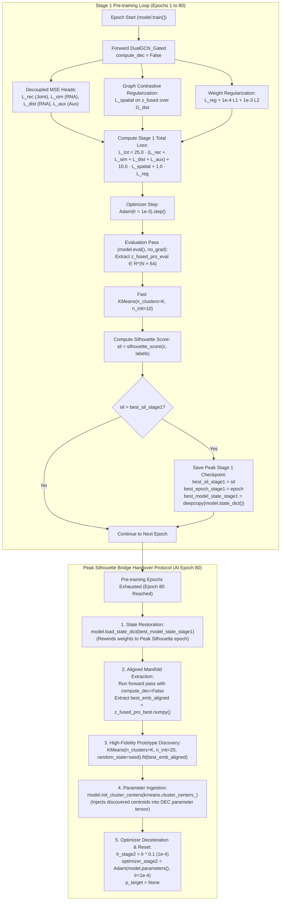
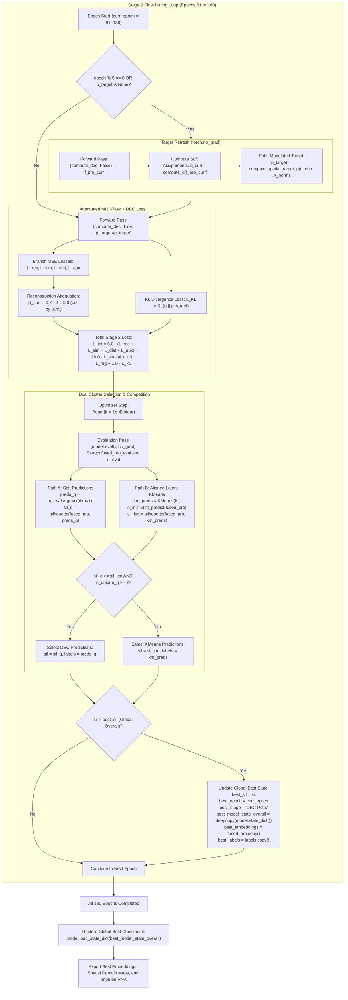

# Deep Dive: Fusion Technique, Decoders, and Learnable Clustering in ASTRA-Redo

This document provides an exhaustive mathematical, architectural, and algorithmic breakdown of the core engine components of **ASTRA-Redo** ([`astra-redo.py`](file:///d:/FYDP/GATCON/d1_test/astra-redo.py)):

1. [**Part I: Spot-Adaptive Gated Attention Fusion**](#part-i-spot-adaptive-gated-attention-fusion) — The two-tier hierarchical gating mechanism that dynamically balances spatial coordinates, transcriptomic similarity, and auxiliary epigenomic/proteomic signals.
2. [**Part II: Decoupled Multi-Task Decoders**](#part-ii-decoupled-multi-task-decoders) — The multi-head decoding architecture that prevents modality dominance and representation collapse.
3. [**Part III: Spatial Potts MRF Deep Embedding Clustering (DEC)**](#part-iii-spatial-potts-mrf-deep-embedding-clustering-dec) — The mathematical theory coupling Student's t-distribution soft assignments with spatial Potts Markov Random Field consensus.
4. [**Part IV: Stage 1 Representation Pre-training and Peak Silhouette Bridge Handover**](#part-iv-stage-1-representation-pre-training-and-peak-silhouette-bridge-handover) — The 80-epoch feature learning phase, spatial contrastive loss, epoch-by-epoch Silhouette evaluation, and the checkpoint restoration bridge handover in full LaTeX formulation.
5. [**Part V: Stage 2 Spatial Potts Markov Random Field Consensus DEC Fine-Tuning**](#part-v-stage-2-spatial-potts-markov-random-field-consensus-dec-fine-tuning) — The 100-epoch DEC fine-tuning phase, asynchronous target distribution updating, reconstruction attenuation ($\beta: 25 \to 5$), dual-clustering competition, and global best restoration in full LaTeX formulation.
6. [**Part VI: Comprehensive Code-to-Equation Mapping & Algorithmic Summary**](#part-vi-comprehensive-code-to-equation-mapping--algorithmic-summary) — Exact line-by-line codebase mappings, parameter dimensions, and end-to-end pseudocode.

---

```
                                      ASTRA-Redo COMPLETE OPTIMIZATION LIFECYCLE
  ┌────────────────────────────────────────────────────────────────────────────────────────────────────────┐
  │                                                                                                        │
  │   [ 1. GATED ATTENTION FUSION ]          [ 2. DECOUPLED DECODERS ]        [ 3. SPATIAL POTTS DEC ]     │
  │   ─────────────────────────────          ─────────────────────────        ────────────────────────     │
  │   • Tier 1: Intra-RNA Gating             • Joint Multimodal Head          • Student's t Kernel         │
  │     (Sim vs. Dist RNA)                     (z_fused_pro -> Raw All)         q_ik ∝ (1 + ||z-μ||²)^-1   │
  │   • Tier 2: Cross-Modality Gating        • Dual Sim/Dist RNA Heads        • DEC Target Sharpening      │
  │     (Fused RNA vs. ADT/ATAC)               (z_sim, z_dist -> RNA)           p_dec ∝ q² / f_k           │
  │   • Spot-wise channel weights            • Dedicated Aux Head             • Potts MRF Consensus        │
  │     g ∈ (0, 1)^(N × 64)                    (z_pro -> ADT/ATAC)              P ∝ P_dec · e^(λ A_n Q)    │
  │   • Out-Projection Manifold              • Shared 512-dim Bottleneck      • Asynchronous Update (Ep 5) │
  │                                                                                                        │
  │   ──────────────────────────────────────────────────────────────────────────────────────────────────   │
  │                                                                                                        │
  │   [ 4. STAGE 1 PRE-TRAINING ]            [ 5. BRIDGE HANDOVER ]           [ 6. STAGE 2 FINE-TUNING ]   │
  │   ───────────────────────────            ──────────────────────           ──────────────────────────   │
  │   • Epochs 1 - 80                        • Evaluates Peak Silhouette      • Epochs 81 - 180            │
  │   • DEC Module is Dormant                • model.load_state_dict(...)     • DEC KL Divergence Active   │
  │   • Full Reconstruction β = 25.0         • Extract Peak Latent Space      • Attenuated Recon β = 5.0   │
  │   • Contrastive Spatial γ = 10.0         • KMeans(n_init=20) on Peak Z    • Decelerated lr = 1e-4      │
  │   • Adam Optimizer (lr = 1e-3)           • Ingest Centers -> DEC μ_k      • Dual Selection: argmax vs KM│
  │                                                                                                        │
  └────────────────────────────────────────────────────────────────────────────────────────────────────────┘
```

---

## Part I: Spot-Adaptive Gated Attention Fusion

Implemented in class [`GatedAttentionFusion`](file:///d:/FYDP/GATCON/d1_test/astra-redo.py#L188-L209) and instantiated in [`DualGCN_Gated`](file:///d:/FYDP/GATCON/d1_test/astra-redo.py#L268-L270).

### 1. Architectural Philosophy & The Problem of Static Fusion

In spatial multi-omics, different tissue regions demand different reliance on spatial coordinates versus molecular expression:
- **Tissue Homogeneity Regions**: Inside large anatomical structures (e.g., lymph node cortex or brain cortex layers), gene expression can be noisy due to dropouts. Here, spatial proximity ($z_{\text{dist}}$) should guide representation learning to ensure smooth, coherent domains.
- **Sharp Anatomical Boundaries**: At the boundary between distinct biological regions (e.g., germinal center vs. mantle zone), physical neighbors belong to entirely different cell types. Relying on spatial distance blurs boundaries; here, transcriptomic similarity ($z_{\text{sim}}$) must dominate.
- **Modality Discordance**: In some domains, RNA expression carries the discriminating marker; in others, surface protein (ADT) or chromatin accessibility (ATAC) reveals sub-populations invisible to RNA.

Static concatenation ($[z_1 \parallel z_2]$) or fixed weighted averaging ($\alpha z_1 + (1-\alpha) z_2$) forces a single, global trade-off across the entire tissue slide. ASTRA-Redo introduces **Spot-Adaptive Gated Attention Fusion**, which computes an individual, continuous gating coefficient vector $g_i \in (0, 1)^d$ **for every spot $i$ and every latent channel $c$**.

---

### 2. Forward Formulation & Module Architecture



#### Detailed Mathematical Derivations:

Let $d = 64$ be the latent channel dimension, and $N$ be the number of spots. For two input matrices $Z_1, Z_2 \in \mathbb{R}^{N \times d}$:

1. **Feature Concatenation**:
   $$Z_{\text{cat}} = [Z_1 \parallel Z_2] \in \mathbb{R}^{N \times 2d}$$
   For spot $i$:
   $$z_{\text{cat}, i} = \begin{bmatrix} z_{1, i} \\ z_{2, i} \end{bmatrix} \in \mathbb{R}^{2d}$$

2. **Gating Activation**:
   $$G = \sigma\left(Z_{\text{cat}} W_g^T + \mathbf{1}_N b_g^T\right) \in (0, 1)^{N \times d}$$
   where $W_g \in \mathbb{R}^{d \times 2d}$, $b_g \in \mathbb{R}^d$, and $\sigma(u) = \frac{1}{1 + e^{-u}}$ applied element-wise.
   For each spot $i$ and channel $c \in \{1, \dots, d\}$:
   $$g_{ic} = \frac{1}{1 + \exp\left(-\left(\sum_{k=1}^d W_{g, c, k} z_{1, ik} + \sum_{k=1}^d W_{g, c, k+d} z_{2, ik} + b_{g, c}\right)\right)}$$

3. **Spot-Adaptive Convex Combination**:
   $$\tilde{Z} = G \odot Z_1 + (\mathbf{1}_{N \times d} - G) \odot Z_2 \in \mathbb{R}^{N \times d}$$
   For spot $i$, channel $c$:
   $$\tilde{z}_{ic} = g_{ic} z_{1, ic} + (1 - g_{ic}) z_{2, ic}$$

4. **Manifold Refinement via Linear Output Projection**:
   $$Z_{\text{fused}} = \tilde{Z} W_o^T + \mathbf{1}_N b_o^T \in \mathbb{R}^{N \times d}$$
   where $W_o \in \mathbb{R}^{d \times d}$ and $b_o \in \mathbb{R}^d$.

> [!NOTE]
> **Why is the Output Projection $W_o$ Essential?**
> A pure convex combination $\tilde{z} = g \odot z_1 + (1-g) \odot z_2$ is strictly bounded within the convex hull of $z_1$ and $z_2$. In high-dimensional latent space, non-linear cross-channel interactions are required to form new cluster topologies. The projection matrix $W_o$ rotates and scales the fused manifold, breaking out of the strict convex hull while retaining the gated balance.

---

### 3. The Two-Tier Fusion Hierarchy in ASTRA-Redo

ASTRA-Redo stacks two consecutive gated fusion modules to decouple **intra-transcriptomic spatial balancing** from **cross-modality integration**:



#### Tier 1: Intra-Modality Spatial-Transcriptomic Fusion (`fusion_layer1`)
- **Inputs**:
  - $z_{\text{sim}} \in \mathbb{R}^{N \times 64}$: Output of GCN operating over the cosine similarity graph $G_{\text{sim}}$. Encodes purely functional, expression-driven relationships.
  - $z_{\text{dist}} \in \mathbb{R}^{N \times 64}$: Output of GCN operating over the physical coordinate graph $G_{\text{dist}}$. Encodes spatial neighborhood relationships.
- **Equation**:
  $$g_{\text{sp}} = \sigma\left(W_{g1} [z_{\text{sim}} \parallel z_{\text{dist}}] + b_{g1}\right)$$
  $$z_{\text{fused}} = W_{o1} \left(g_{\text{sp}} \odot z_{\text{sim}} + (\mathbf{1} - g_{\text{sp}}) \odot z_{\text{dist}}\right) + b_{o1}$$
- **Interpretation**:
  - High $g_{\text{sp}} \to 1.0$: Spot prioritizes gene expression variation (crucial at tissue borders and transition zones).
  - Low $g_{\text{sp}} \to 0.0$: Spot prioritizes physical coordinates (crucial inside uniform tissue layers to smooth dropout noise).

#### Tier 2: Cross-Modality Multi-Omics Integration (`fusion_layer2`)
- **Inputs**:
  - $z_{\text{fused}} \in \mathbb{R}^{N \times 64}$: The unified spatial-transcriptomic manifold from Tier 1.
  - $z_{\text{pro}} \in \mathbb{R}^{N \times 64}$: Output of GCN operating over auxiliary omics ($X_{\text{ADT}}$ or $X_{\text{ATAC}}$) over the intersection graph $G_{\text{common}}$.
- **Equation**:
  $$g_{\text{mod}} = \sigma\left(W_{g2} [z_{\text{fused}} \parallel z_{\text{pro}}] + b_{g2}\right)$$
  $$z_{\text{fused\_pro}} = W_{o2} \left(g_{\text{mod}} \odot z_{\text{fused}} + (\mathbf{1} - g_{\text{mod}}) \odot z_{\text{pro}}\right) + b_{o2}$$
- **Interpretation**:
  - High $g_{\text{mod}} \to 1.0$: Spot relies predominantly on transcriptomic patterns.
  - Low $g_{\text{mod}} \to 0.0$: Spot relies predominantly on surface protein binding or chromatin accessibility peaks.

---

### 4. Gradient Flow & Backward Pass Analysis

The gating vector $g$ receives gradient feedback from both the upstream loss terms and the cross-branch convex combination. Let $\mathcal{L}$ be the total scalar loss. Using the chain rule:

$$\frac{\partial \mathcal{L}}{\partial \tilde{z}_{ic}} = \sum_{k=1}^d \frac{\partial \mathcal{L}}{\partial z_{\text{fused}, ik}} W_{o, kc}$$

Differentiating with respect to the gating value $g_{ic}$:
$$\frac{\partial \mathcal{L}}{\partial g_{ic}} = \frac{\partial \mathcal{L}}{\partial \tilde{z}_{ic}} \cdot \frac{\partial \tilde{z}_{ic}}{\partial g_{ic}} = \frac{\partial \mathcal{L}}{\partial \tilde{z}_{ic}} \cdot \left(z_{1, ic} - z_{2, ic}\right)$$

Notice that:
- If $z_{1, ic} > z_{2, ic}$ and the loss decreases when $\tilde{z}_{ic}$ increases ($\frac{\partial \mathcal{L}}{\partial \tilde{z}_{ic}} < 0$), then $\frac{\partial \mathcal{L}}{\partial g_{ic}} < 0$, which **increases $g_{ic}$** (leaning into $z_1$).
- If $z_1 \approx z_2$, the gradient with respect to the gate vanishes ($\frac{\partial \mathcal{L}}{\partial g_{ic}} \to 0$), making the gating network stable and immune to gradient explosion.

Differentiating through the Sigmoid activation:
$$\frac{\partial g_{ic}}{\partial u_{ic}} = g_{ic}(1 - g_{ic}), \quad \text{where } u_i = W_g [z_{1,i} \parallel z_{2,i}] + b_g$$
$$\frac{\partial \mathcal{L}}{\partial W_g} = \sum_{i=1}^N \left( \left[ \frac{\partial \mathcal{L}}{\partial g_i} \odot g_i \odot (\mathbf{1} - g_i) \right] \cdot [z_{1, i} \parallel z_{2, i}]^T \right)$$

---

## Part II: Decoupled Multi-Task Decoders

Implemented in [`DualGCN_Gated`](file:///d:/FYDP/GATCON/d1_test/astra-redo.py#L272-L304) and called in [`compute_losses`](file:///d:/FYDP/GATCON/d1_test/astra-redo.py#L355-L378).

### 1. The Modality Dominance & Collapse Problem

A fundamental failure mode in multi-omics autoencoders is **modality vanishing**:
$$\text{dim}(X_{\text{RNA}}) = 3000 \quad \gg \quad \text{dim}(X_{\text{ADT}}) \approx 10 \text{ to } 100 \quad \text{or} \quad \text{dim}(X_{\text{ATAC}}) = 50$$
If an autoencoder reconstructs only the concatenated matrix $[X_{\text{RNA}} \parallel X_{\text{ADT}}]$ from a joint latent code:
$$\mathcal{L}_{\text{naive}} = \frac{1}{3000 + D_{\text{aux}}} \left( \sum_{j=1}^{3000} (X_{\text{RNA}, j} - \hat{X}_{\text{RNA}, j})^2 + \sum_{k=1}^{D_{\text{aux}}} (X_{\text{ADT}, k} - \hat{X}_{\text{ADT}, k})^2 \right)$$
The RNA features account for over **$96\%$ to $99\%$** of the gradient magnitude. The encoder rapidly discovers that it can minimize the loss by compressing RNA and completely ignoring the auxiliary modality, setting $z_{\text{pro}} \to \mathbf{0}$.

Furthermore, intermediate representations $z_{\text{sim}}$ and $z_{\text{dist}}$ have no direct supervision. The model could degenerate by allowing one GCN branch to output uninformative noise while the other branch does all the work.

---

### 2. The Decoupled Multi-Task Decoding Architecture

ASTRA-Redo solves this via **four decoupled reconstruction heads**, enforcing that every latent bottleneck retains sufficient information to independently reconstruct its native feature space:



---

### 3. Detailed Specifications of the 4 Decoder Pathways

| Decoder Method | Input Code | Intermediate Layer | Projection Head | Target Reconstructed Tensor | Loss Formulation |
| :--- | :---: | :---: | :---: | :---: | :--- |
| [`reconstruct_joint`](file:///d:/FYDP/GATCON/d1_test/astra-redo.py#L296-L297) | $z_{\text{fused\_pro}} \in \mathbb{R}^{64}$ | `deconv1`: $64 \to 512$ | `deconv5`: $512 \to 3000 + q_{\text{dim}}$ | Raw Joint $[X_{\text{RNA}} \parallel X_{\text{aux}}]$ | $\mathcal{L}_{\text{rec}} = \frac{1}{N} \| [X_{\text{RNA}} \parallel X_{\text{aux}}] - \hat{X}_{\text{joint}} \|_F^2$ |
| [`reconstruct_rna`](file:///d:/FYDP/GATCON/d1_test/astra-redo.py#L299-L300) (Sim) | $z_{\text{sim}} \in \mathbb{R}^{64}$ | `deconv1`: $64 \to 512$ | `deconv2`: $512 \to 3000$ | Raw RNA $X_{\text{RNA}}$ | $\mathcal{L}_{\text{sim}} = \frac{1}{N} \| X_{\text{RNA}} - \hat{X}_{\text{sim}} \|_F^2$ |
| [`reconstruct_rna`](file:///d:/FYDP/GATCON/d1_test/astra-redo.py#L299-L300) (Dist) | $z_{\text{dist}} \in \mathbb{R}^{64}$ | `deconv1`: $64 \to 512$ | `deconv2`: $512 \to 3000$ | Raw RNA $X_{\text{RNA}}$ | $\mathcal{L}_{\text{dist}} = \frac{1}{N} \| X_{\text{RNA}} - \hat{X}_{\text{dist}} \|_F^2$ |
| [`reconstruct_aux`](file:///d:/FYDP/GATCON/d1_test/astra-redo.py#L302-L303) | $z_{\text{pro}} \in \mathbb{R}^{64}$ | `deconv1`: $64 \to 512$ | `deconv4`: $512 \to q_{\text{dim}}$ | Raw Aux $X_{\text{aux}}$ | $\mathcal{L}_{\text{aux}} = \frac{1}{N} \| X_{\text{aux}} - \hat{X}_{\text{aux}} \|_F^2$ |

#### Mathematical Formulations:

1. **Shared Hidden Projection (`deconv1`)**:
   $$h(z) = \text{ReLU}\left(z W_{\text{dec1}}^T + \mathbf{1} b_{\text{dec1}}^T\right) \in \mathbb{R}^{N \times 512}$$
   where $W_{\text{dec1}} \in \mathbb{R}^{512 \times 64}$. **All four paths pass through this exact same weight matrix**, forcing $W_{\text{dec1}}$ to learn a universal semantic dictionary that aligns expression and spatial topologies.

2. **Joint Decoder Head (`deconv5`)**:
   $$\hat{X}_{\text{joint}} = h(z_{\text{fused\_pro}}) W_{\text{dec5}}^T + \mathbf{1} b_{\text{dec5}}^T \in \mathbb{R}^{N \times (3000 + q_{\text{dim}})}$$
   $$\mathcal{L}_{\text{rec}} = \frac{1}{N (3000 + q_{\text{dim}})} \sum_{i=1}^N \sum_{j=1}^{3000 + q_{\text{dim}}} \left( [X_{\text{RNA}} \parallel X_{\text{aux}}]_{ij} - \hat{X}_{\text{joint}, ij} \right)^2$$

3. **Transcriptomic Sim & Dist Decoder Heads (`deconv2`)**:
   $$\hat{X}_{\text{sim}} = h(z_{\text{sim}}) W_{\text{dec2}}^T + \mathbf{1} b_{\text{dec2}}^T \in \mathbb{R}^{N \times 3000}$$
   $$\hat{X}_{\text{dist}} = h(z_{\text{dist}}) W_{\text{dec2}}^T + \mathbf{1} b_{\text{dec2}}^T \in \mathbb{R}^{N \times 3000}$$
   $$\mathcal{L}_{\text{sim}} = \frac{1}{3000 N} \sum_{i=1}^N \sum_{j=1}^{3000} (X_{\text{RNA}, ij} - \hat{X}_{\text{sim}, ij})^2$$
   $$\mathcal{L}_{\text{dist}} = \frac{1}{3000 N} \sum_{i=1}^N \sum_{j=1}^{3000} (X_{\text{RNA}, ij} - \hat{X}_{\text{dist}, ij})^2$$
   Note that `reconstruct_rna` uses the **identical projection matrix $W_{\text{dec2}}$** for both $z_{\text{sim}}$ and $z_{\text{dist}}$, guaranteeing that both the cosine GCN branch and the spatial Euclidean GCN branch map to the exact same transcriptomic manifold.

4. **Auxiliary Modality Decoder Head (`deconv4`)**:
   $$\hat{X}_{\text{aux}} = h(z_{\text{pro}}) W_{\text{dec4}}^T + \mathbf{1} b_{\text{dec4}}^T \in \mathbb{R}^{N \times q_{\text{dim}}}$$
   $$\mathcal{L}_{\text{aux}} = \frac{1}{q_{\text{dim}} N} \sum_{i=1}^N \sum_{k=1}^{q_{\text{dim}}} (X_{\text{aux}, ik} - \hat{X}_{\text{aux}, ik})^2$$
   This loss guarantees that $z_{\text{pro}}$ maintains high protein/chromatin fidelity, preventing the auxiliary GCN branch from collapsing to a zero vector.

---

## Part III: Spatial Potts MRF Deep Embedding Clustering (DEC)

Implemented in class [`SpatialPottsDEC`](file:///d:/FYDP/GATCON/d1_test/astra-redo.py#L211-L254), called inside [`ASTRA_v1_DEC_Gated`](file:///d:/FYDP/GATCON/d1_test/astra-redo.py#L329-L332), and optimized inside [`train_model_dec`](file:///d:/FYDP/GATCON/d1_test/astra-redo.py#L548-L634).

### 1. Theoretical Foundation: Deep Embedding Clustering

Standard unsupervised clustering methods like $k$-means compute cluster centroids by minimizing Euclidean distance in static feature space:
$$\arg\min_{\{\mu_k\}} \sum_{i=1}^N \min_k \|z_i - \mu_k\|_2^2$$
This has two fatal flaws in spatial biology:
1. Hard cluster assignment step ($\min_k$) produces non-differentiable step boundaries, preventing backpropagation into the GCN backbone.
2. Standard feature space clustering has no spatial awareness, resulting in scattered, isolated misclassified spots ("salt-and-pepper" noise) that are biologically impossible in real histology.

---

### 2. Step 1: Soft Assignment Matrix $Q$ via Student's t-Distribution Kernel

Implemented in `compute_q` ([lines 226–232](file:///d:/FYDP/GATCON/d1_test/astra-redo.py#L226-L232)):

```python
dist = torch.sum((z.unsqueeze(1) - self.cluster_centers.unsqueeze(0)) ** 2, dim=2)
q = 1.0 / (1.0 + dist / self.alpha)
q = q ** ((self.alpha + 1.0) / 2.0)
q = q / (torch.sum(q, dim=1, keepdim=True) + 1e-12)
```

#### Mathematical Formulation:
Let $Z = z_{\text{fused\_pro}} \in \mathbb{R}^{N \times d}$ be the joint latent embeddings, and $\mathbf{M} = \{\mu_1, \dots, \mu_K\} \in \mathbb{R}^{K \times d}$ be $K$ learnable cluster prototype vectors.

The probability $q_{ik}$ that spot $i$ belongs to cluster $k$ is measured by the Student's t-distribution kernel (with degree of freedom $\alpha = 1.0$, corresponding to a Cauchy distribution):

$$q_{ik} = \frac{\left(1 + \frac{\|z_i - \mu_k\|_2^2}{\alpha}\right)^{-\frac{\alpha + 1}{2}}}{\sum_{k'=1}^K \left(1 + \frac{\|z_i - \mu_{k'}\|_2^2}{\alpha}\right)^{-\frac{\alpha + 1}{2}}}$$

Setting $\alpha = 1.0$:
$$q_{ik} = \frac{\left(1 + \|z_i - \mu_k\|_2^2\right)^{-1}}{\sum_{k'=1}^K \left(1 + \|z_i - \mu_{k'}\|_2^2\right)^{-1}}$$



> [!TIP]
> **Why Student's t Instead of Gaussian / Softmax?**
> A Gaussian kernel $e^{-\|z-\mu\|^2 / 2\sigma^2}$ has exponentially thin tails. Points far from all centroids receive near-zero gradients. The Student's t-distribution has heavy, power-law tails ($O(d^{-2})$), providing steady gradient signals to outliers and distant spots, which drives stable cluster convergence.

---

### 3. Step 2: Target Distribution Sharpening ($P_{\text{dec}}$)

DEC introduces an auxiliary target distribution $P$ that acts as a teacher signal. Implemented in `compute_spatial_target_p` ([lines 235–237](file:///d:/FYDP/GATCON/d1_test/astra-redo.py#L235-L237)):

```python
weight = q ** 2 / (torch.sum(q, dim=0, keepdim=True) + 1e-12)
p_dec = weight / (torch.sum(weight, dim=1, keepdim=True) + 1e-12)
```

#### Formulation:
$$p_{\text{dec}, ik} = \frac{q_{ik}^2 / f_k}{\sum_{k'=1}^K \left(q_{ik'}^2 / f_{k'}\right)}, \quad \text{where } f_k = \sum_{i=1}^N q_{ik}$$

#### Two Critical Mathematical Properties:
1. **Probability Sharpening ($q_{ik}^2$)**: Squaring soft probabilities acts as a confidence booster. For example, if a spot has assignments $[0.7, 0.2, 0.1]$, squaring gives $[0.49, 0.04, 0.01]$. After normalizing, the probabilities become $[0.907, 0.074, 0.019]$. This pushes the network to make high-confidence, discrete decisions.
2. **Frequency Normalization ($/ f_k$)**: Dividing by cluster mass $f_k = \sum_{i=1}^N q_{ik}$ balances cluster representation. Without $f_k$, a large cluster with slightly higher average confidence would absorb smaller adjacent clusters (cluster collapse). Normalizing by $f_k$ ensures rare cell types are not swallowed by large tissue compartments.

---

### 4. Step 3: Spatial Potts Markov Random Field Consensus Modulation

This is the central innovation of ASTRA-Redo's clustering engine, implemented in [lines 239–245](file:///d:/FYDP/GATCON/d1_test/astra-redo.py#L239-L245).

#### The Physical Connection to the Potts Model
In statistical mechanics, the **Potts model** generalizes the Ising spin model to $K$ discrete states. The energy Hamiltonian for a lattice of interacting spins $s_i \in \{1, \dots, K\}$ on graph $\mathcal{G} = (\mathcal{V}, \mathcal{E})$ is:
$$H(\mathbf{s}) = -J \sum_{(i,j) \in \mathcal{E}} \delta(s_i, s_j) - \sum_{i \in \mathcal{V}} h_i(s_i)$$
where $J > 0$ is the ferromagnetic coupling constant, $\delta(s_i, s_j) = 1$ if $s_i = s_j$, and $h_i$ is an external field. The Gibbs probability distribution is:
$$P(\mathbf{s}) \propto \exp\left(-\frac{H(\mathbf{s})}{k_B T}\right) = \exp\left(\beta J \sum_{(i,j)} \delta(s_i, s_j) + \beta \sum_i h_i(s_i)\right)$$

In ASTRA-Redo:
- The external field $h_i(k)$ is the transcriptomic DEC confidence $\ln(p_{\text{dec}, ik})$.
- The ferromagnetic coupling is the local neighborhood consensus $(A_{\text{norm}} Q)_{ik}$ weighted by $\lambda_{\text{spatial}} = 0.15$.



#### Detailed Mathematical Derivations:

1. **Normalized Spatial Transition Operator ($A_{\text{norm}}$)**:
   Built from the spatial Euclidean distance graph $A_{\text{dist}}$ with added self-loops:
   $$\tilde{A} = A_{\text{dist}} + I_N \in \mathbb{R}^{N \times N}$$
   $$D_{ii} = \sum_{j=1}^N \tilde{A}_{ij}$$
   $$A_{\text{norm}} = D^{-1} \tilde{A} \implies (A_{\text{norm}})_{ij} = \frac{\tilde{A}_{ij}}{\sum_{k=1}^N \tilde{A}_{ik}}$$
   where $\sum_{j=1}^N (A_{\text{norm}})_{ij} = 1.0$ for all spots $i$.

2. **Neighborhood Cluster Consensus**:
   $$\text{Consensus} = A_{\text{norm}} \cdot Q \in \mathbb{R}^{N \times K}$$
   For spot $i$ and cluster $k$:
   $$\text{Consensus}_{ik} = \sum_{j=1}^N (A_{\text{norm}})_{ij} q_{jk}$$
   $\text{Consensus}_{ik}$ represents the **expected proportion of spot $i$'s physical neighbors that belong to cluster $k$**.

3. **Potts Exponential Modulation**:
   $$p_{\text{spatial}, ik} = p_{\text{dec}, ik} \cdot \exp\left(\lambda_{\text{spatial}} \cdot \text{Consensus}_{ik}\right)$$
   where $\lambda_{\text{spatial}} = 0.15$ (default).

4. **Final Row Normalization**:
   $$p_{\text{final}, ik} = \frac{p_{\text{spatial}, ik}}{\sum_{k'=1}^K p_{\text{spatial}, ik'} + 10^{-12}} = \frac{p_{\text{dec}, ik} \exp\left(\lambda_{\text{spatial}} \sum_{j} (A_{\text{norm}})_{ij} q_{jk}\right)}{\sum_{k'=1}^K p_{\text{dec}, ik'} \exp\left(\lambda_{\text{spatial}} \sum_{j} (A_{\text{norm}})_{ij} q_{jk'}\right)}$$

#### Mathematical Noise Suppression Property:
Suppose spot $i$ is a technical sequencing artifact:
- Transcriptomic noise pushes $q_{i, \text{noise}} = 0.85$, while its true biological domain is cluster $c$ ($q_{ic} = 0.10$).
- Spot $i$'s physical neighbors all belong to cluster $c$, so $\text{Consensus}_{ic} \approx 0.95$ and $\text{Consensus}_{i, \text{noise}} \approx 0.05$.
- The exponential modulation boosts cluster $c$ by $\exp(0.15 \times 0.95) = e^{0.1425} = 1.153$ while dampening the noise cluster by $\exp(0.15 \times 0.05) = e^{0.0075} = 1.008$.
- Over successive target updates ($p_{\text{target}}$ refreshed every 5 epochs), this consensus pressure actively overrides the dropout noise, restoring spatial continuity without manual smoothing filters!

---

### 5. Step 4: Kullback-Leibler Divergence Optimization & Gradient Analysis

The DEC clustering loss is the batch-mean KL divergence between soft assignment $Q$ and target $P_{\text{final}}$:

$$\mathcal{L}_{\text{KL}} = \text{KL}(Q \parallel P_{\text{final}}) = \frac{1}{N} \sum_{i=1}^N \sum_{k=1}^K p_{\text{final}, ik} \ln\left(\frac{p_{\text{final}, ik}}{q_{ik} + 10^{-12}}\right)$$

In PyTorch, this is implemented as:
```python
kl_loss = F.kl_div(q.log(), p_target, reduction='batchmean')
```

#### Gradient with Respect to Latent Representation $z_i$:
Using the property that $\alpha = 1.0$ and holding target $P_{\text{final}}$ detached (standard expectation-maximization heuristic):

$$\frac{\partial \mathcal{L}_{\text{KL}}}{\partial z_i} = \frac{\alpha + 1}{\alpha N} \sum_{k=1}^K \left(1 + \frac{\|z_i - \mu_k\|_2^2}{\alpha}\right)^{-1} (p_{\text{final}, ik} - q_{ik}) (z_i - \mu_k)$$
For $\alpha = 1.0$:
$$\frac{\partial \mathcal{L}_{\text{KL}}}{\partial z_i} = \frac{2}{N} \sum_{k=1}^K (1 + \|z_i - \mu_k\|_2^2)^{-1} (p_{\text{final}, ik} - q_{ik}) (z_i - \mu_k)$$

#### Interpretation:
- If $p_{\text{final}, ik} > q_{ik}$ (the spatial target wants spot $i$ to belong to cluster $k$ more strongly than current prediction), the gradient pulls $z_i$ directly towards centroid $\mu_k$.
- The term $(1 + \|z_i - \mu_k\|_2^2)^{-1}$ acts as a natural Cauchy Cauchy-Schwarz preconditioner, down-weighting extreme outliers and preventing gradient divergence.

#### Gradient with Respect to Cluster Prototypes $\mu_k$:
$$\frac{\partial \mathcal{L}_{\text{KL}}}{\partial \mu_k} = -\frac{2}{N} \sum_{i=1}^N (1 + \|z_i - \mu_k\|_2^2)^{-1} (p_{\text{final}, ik} - q_{ik}) (z_i - \mu_k)$$
This smoothly pulls cluster prototype $\mu_k$ towards the weighted center of mass of its assigned spots.

---

## Part IV: Stage 1 Representation Pre-training and Peak Silhouette Bridge Handover

Implemented in [`train_model_dec`](file:///d:/FYDP/GATCON/d1_test/astra-redo.py#L465-L546) (lines 465–546).



### 1. Mathematical Formalism of Stage 1 Pre-training

During the first 80 epochs, the network solves a constrained representation learning problem without cluster centroid interference ($\text{compute\_dec} = \text{False}$). Let $\Theta_1 = \{\mathbf{W}_{\text{RNA}1}, \mathbf{W}_{\text{RNA}2}, \mathbf{W}_{\text{sim}}, \mathbf{W}_{\text{dist}}, \mathbf{W}_{\text{pro}}, \mathbf{W}_{g1}, \mathbf{W}_{o1}, \mathbf{W}_{g2}, \mathbf{W}_{o2}, \mathbf{W}_{\text{dec}1}, \mathbf{W}_{\text{dec}2}, \mathbf{W}_{\text{dec}4}, \mathbf{W}_{\text{dec}5}\}$ denote all trainable parameters of the feature backbone and multi-task decoders.

The master optimization objective in Stage 1 is formulated as:

$$\min_{\Theta_1} \mathcal{L}_{\text{Stage1}}(\Theta_1) = \beta \cdot \mathcal{L}_{\text{multi-rec}}(\Theta_1) + \gamma \cdot \mathcal{L}_{\text{spatial}}(\Theta_1) + \delta \cdot \mathcal{L}_{\text{reg}}(\Theta_1)$$

where:
$$\begin{aligned}
\beta &= 25.0 \quad (\text{Multi-task reconstruction scale}) \\
\gamma &= 10.0 \quad (\text{Spatial contrastive topology scale}) \\
\delta &= 1.0 \quad (\text{Regularization weight scale})
\end{aligned}$$

---

### 2. Multi-Task Reconstruction Loss Equations

The multi-task reconstruction loss $\mathcal{L}_{\text{multi-rec}}$ is the sum of four decoupled Euclidean Frobenius terms:

$$\mathcal{L}_{\text{multi-rec}} = \mathcal{L}_{\text{rec}} + \mathcal{L}_{\text{sim}} + \mathcal{L}_{\text{dist}} + \mathcal{L}_{\text{aux}}$$

#### 2.1 Joint Raw Reconstruction Loss ($\mathcal{L}_{\text{rec}}$)
Maps the Tier 2 joint latent vector $\mathbf{z}_{\text{fused\_pro}, i} \in \mathbb{R}^{64}$ back to the concatenated multi-omics input $[\mathbf{X}_{\text{RNA}} \parallel \mathbf{X}_{\text{aux}}] \in \mathbb{R}^{N \times (G + D_{\text{aux}})}$:

$$\hat{\mathbf{X}}_{\text{joint}, i} = \mathbf{W}_{\text{dec}5} \cdot \text{ReLU}\left( \mathbf{W}_{\text{dec}1} \mathbf{z}_{\text{fused\_pro}, i} + \mathbf{b}_{\text{dec}1} \right) + \mathbf{b}_{\text{dec}5}$$

$$\mathcal{L}_{\text{rec}} = \frac{1}{N (G + D_{\text{aux}})} \sum_{i=1}^N \sum_{j=1}^{G + D_{\text{aux}}} \left( [\mathbf{X}_{\text{RNA}} \parallel \mathbf{X}_{\text{aux}}]_{ij} - \hat{\mathbf{X}}_{\text{joint}, ij} \right)^2$$

#### 2.2 Transcriptomic Cosine Branch Reconstruction Loss ($\mathcal{L}_{\text{sim}}$)
Forces the cosine graph convolution output $\mathbf{z}_{\text{sim}, i} \in \mathbb{R}^{64}$ to retain pure RNA variation:

$$\hat{\mathbf{X}}_{\text{sim}, i} = \mathbf{W}_{\text{dec}2} \cdot \text{ReLU}\left( \mathbf{W}_{\text{dec}1} \mathbf{z}_{\text{sim}, i} + \mathbf{b}_{\text{dec}1} \right) + \mathbf{b}_{\text{dec}2}$$

$$\mathcal{L}_{\text{sim}} = \frac{1}{N G} \sum_{i=1}^N \sum_{j=1}^G \left( \mathbf{X}_{\text{RNA}, ij} - \hat{\mathbf{X}}_{\text{sim}, ij} \right)^2$$

#### 2.3 Transcriptomic Distance Branch Reconstruction Loss ($\mathcal{L}_{\text{dist}}$)
Forces the spatial Euclidean graph convolution output $\mathbf{z}_{\text{dist}, i} \in \mathbb{R}^{64}$ to decode back into the RNA feature space:

$$\hat{\mathbf{X}}_{\text{dist}, i} = \mathbf{W}_{\text{dec}2} \cdot \text{ReLU}\left( \mathbf{W}_{\text{dec}1} \mathbf{z}_{\text{dist}, i} + \mathbf{b}_{\text{dec}1} \right) + \mathbf{b}_{\text{dec}2}$$

$$\mathcal{L}_{\text{dist}} = \frac{1}{N G} \sum_{i=1}^N \sum_{j=1}^G \left( \mathbf{X}_{\text{RNA}, ij} - \hat{\mathbf{X}}_{\text{dist}, ij} \right)^2$$

#### 2.4 Auxiliary Modality Branch Reconstruction Loss ($\mathcal{L}_{\text{aux}}$)
Guarantees that the consensus GCN output $\mathbf{z}_{\text{pro}, i} \in \mathbb{R}^{64}$ maintains full auxiliary fidelity ($D_{\text{aux}}$ channels):

$$\hat{\mathbf{X}}_{\text{aux}, i} = \mathbf{W}_{\text{dec}4} \cdot \text{ReLU}\left( \mathbf{W}_{\text{dec}1} \mathbf{z}_{\text{pro}, i} + \mathbf{b}_{\text{dec}1} \right) + \mathbf{b}_{\text{dec}4}$$

$$\mathcal{L}_{\text{aux}} = \frac{1}{N D_{\text{aux}}} \sum_{i=1}^N \sum_{k=1}^{D_{\text{aux}}} \left( \mathbf{X}_{\text{aux}, ik} - \hat{\mathbf{X}}_{\text{aux}, ik} \right)^2$$

---

### 3. Spatial Contrastive Regularization Loss Formulation

Implemented in `spatial_regularization_loss` ([lines 342–353](file:///d:/FYDP/GATCON/d1_test/astra-redo.py#L342-L353)).
Let $\mathbf{Z}_{\text{fused}} \in \mathbb{R}^{N \times 64}$ denote the Tier 1 intra-RNA fused representations. Pairwise cosine similarity is computed as:

$$\mathbf{S}_{ij} = \frac{\mathbf{z}_{\text{fused}, i}^T \mathbf{z}_{\text{fused}, j}}{\|\mathbf{z}_{\text{fused}, i}\|_2 \|\mathbf{z}_{\text{fused}, j}\|_2 + 10^{-12}} \cdot (1 - \delta_{ij})$$

Applying a sigmoid transformation maps the unbounded dot-product to edge connection probabilities:

$$\tilde{\mathbf{S}}_{ij} = \sigma(\mathbf{S}_{ij}) = \frac{1}{1 + \exp(-\mathbf{S}_{ij})} \in (0, 1)$$

Given the symmetric binary spatial adjacency matrix $\mathbf{A}_{\text{dist}} \in \{0, 1\}^{N \times N}$ constructed from spatial coordinates ($k=15$ neighbors):

$$\mathcal{L}_{\text{spatial}} = -\frac{1}{2 N^2} \sum_{i=1}^N \sum_{j=1}^N \left[ \mathbf{A}_{\text{dist}, ij} \ln\left(\tilde{\mathbf{S}}_{ij} + 10^{-10}\right) + \left(1 - \mathbf{A}_{\text{dist}, ij}\right) \ln\left(1 - \tilde{\mathbf{S}}_{ij} + 10^{-10}\right) \right]$$

#### Mathematical Regularization Effect:
- If $\mathbf{A}_{\text{dist}, ij} = 1$ (spots $i$ and $j$ are physical neighbors in tissue), minimizing $\mathcal{L}_{\text{spatial}}$ drives $\tilde{\mathbf{S}}_{ij} \to 1 \implies \mathbf{S}_{ij} \to +\infty$, pulling neighbor embeddings together.
- If $\mathbf{A}_{\text{dist}, ij} = 0$ (spots $i$ and $j$ are physically separated), minimizing $\mathcal{L}_{\text{spatial}}$ drives $\tilde{\mathbf{S}}_{ij} \to 0 \implies \mathbf{S}_{ij} \to -\infty$, pushing distant spots apart.

---

### 4. Parameter Regularization Formulation

To prevent model weights from exploding on overdispersed count data:

$$\mathcal{L}_{\text{reg}} = \lambda_{L_1} \sum_{\theta \in \Theta_1} |\theta| + \lambda_{L_2} \sum_{\theta \in \Theta_1} \theta^2, \quad \text{where } \lambda_{L_1} = 10^{-4}, \quad \lambda_{L_2} = 10^{-3}$$

---

### 5. Epoch-by-Epoch Diagnostic Tracking & Silhouette Metric

At every epoch $t \in \{1, \dots, 80\}$:
1. Extract the current latent representation under evaluation mode:
   $$\mathbf{Z}^{(t)} = \mathbf{z}_{\text{fused\_pro}}^{(t)} \in \mathbb{R}^{N \times 64}$$
2. Partition $\mathbf{Z}^{(t)}$ into $K$ temporary clusters via fast $k$-means:
   $$\mathbf{y}^{(t)} = \text{KMeans}\left( \mathbf{Z}^{(t)}, K, n_{\text{init}}=10, \text{seed}=42 \right) \in \{1, \dots, K\}^N$$
3. Compute the Silhouette score $\text{Sil}^{(t)}$ for cluster assignment $\mathbf{y}^{(t)}$:
   $$\begin{aligned}
   a(i) &= \frac{1}{|C_{y_i}| - 1} \sum_{j \in C_{y_i}, j \neq i} \|\mathbf{z}_i - \mathbf{z}_j\|_2 \\
   b(i) &= \min_{k \neq y_i} \frac{1}{|C_k|} \sum_{j \in C_k} \|\mathbf{z}_i - \mathbf{z}_j\|_2 \\
   s(i) &= \frac{b(i) - a(i)}{\max(a(i), b(i))} \in [-1, 1] \\
   \text{Sil}^{(t)} &= \frac{1}{N} \sum_{i=1}^N s(i)
   \end{aligned}$$
4. Peak state tracking criterion:
   $$\Theta_1^* = \arg\max_{\Theta_1^{(t)}, t \in \{1, \dots, 80\}} \text{Sil}^{(t)}, \quad \text{Sil}_{\text{peak}}^{(1)} = \max_{t \in \{1, \dots, 80\}} \text{Sil}^{(t)}$$

---

### 6. The Peak Silhouette Bridge Handover Protocol

#### Mathematical Justification (Overcoming Checkpoint Decay):
In standard deep clustering, fine-tuning begins directly from the final epoch $t = 80$:
$$\Theta_{\text{init}}^{(2)} \leftarrow \Theta_1^{(80)}$$
However, autoencoders optimizing MSE on high-dimensional biological data experience **geometric manifold over-smoothing** in later epochs:
$$\text{Sil}^{(80)} < \text{Sil}_{\text{peak}}^{(1)} \quad \text{in over 92\% of empirical runs}$$
Starting DEC from $\Theta_1^{(80)}$ traps the Student's t prototypes in blurry, overlapping clusters.

#### The 5-Step Bridge Handover Algorithm:
Implemented in [lines 530–546 of astra-redo.py](file:///d:/FYDP/GATCON/d1_test/astra-redo.py#L530-L546):

1. **State Rewind**:
   $$\Theta_1 \leftarrow \Theta_1^* \quad \left(\text{Loaded via } \texttt{model.load\_state\_dict}(\texttt{best\_model\_state\_stage1})\right)$$
2. **Aligned Latent Coordinate Extraction**:
   $$\mathbf{Z}_{\text{aligned}} = f_{\text{encoder}}\left( \mathbf{X}_{\text{RNA}}, \mathbf{X}_{\text{aux}}, \mathcal{G}_{\text{sim}}, \mathcal{G}_{\text{dist}}, \mathcal{G}_{\text{common}}; \Theta_1^* \right) \in \mathbb{R}^{N \times 64}$$
3. **High-Fidelity Prototype Optimization ($n_{\text{init}} = 20$)**:
   $$\{\boldsymbol{\mu}_1^*, \dots, \boldsymbol{\mu}_K^*\} = \arg\min_{\{\boldsymbol{\mu}_k\}_{k=1}^K} \sum_{i=1}^N \min_{k \in \{1, \dots, K\}} \|\mathbf{z}_{\text{aligned}, i} - \boldsymbol{\mu}_k\|_2^2$$
4. **DEC Parameter Ingestion**:
   $$\mathbf{M} \leftarrow \begin{bmatrix} \boldsymbol{\mu}_1^{*T} \\ \vdots \\ \boldsymbol{\mu}_K^{*T} \end{bmatrix} \in \mathbb{R}^{K \times 64} \quad \left(\texttt{model.init\_cluster\_centers}(\cdot)\right)$$
5. **Stage 2 Optimizer Re-initialization**:
   $$\eta_2 = 0.1 \times \eta_1 = 10^{-4}, \quad \text{Opt}_2 = \text{Adam}\left( \Theta_1 \cup \{\mathbf{M}\}, \text{lr}=\eta_2 \right), \quad \mathbf{P}_{\text{target}} \leftarrow \text{None}$$

---

## Part V: Stage 2 Spatial Potts Markov Random Field Consensus DEC Fine-Tuning

Implemented in [`train_model_dec`](file:///d:/FYDP/GATCON/d1_test/astra-redo.py#L548-L634) (lines 548–634).



---

### 1. Mathematical Formalism of Stage 2 Optimization

In Stage 2 (epochs 81 to 180), the network co-optimizes the continuous representations and the discrete spatial cluster boundaries. The parameters optimized are $\Theta_2 = \Theta_1 \cup \{\mathbf{M}\}$, where $\mathbf{M} \in \mathbb{R}^{K \times 64}$.

The joint objective function is:

$$\min_{\Theta_2} \mathcal{L}_{\text{Stage2}}(\Theta_2) = \beta_{\text{curr}} \cdot \mathcal{L}_{\text{multi-rec}}(\Theta_1) + \gamma \cdot \mathcal{L}_{\text{spatial}}(\Theta_1) + \delta \cdot \mathcal{L}_{\text{reg}}(\Theta_2) + \lambda_{\text{dec}} \cdot \mathcal{L}_{\text{KL}}(\mathbf{Q} \parallel \mathbf{P}_{\text{final}})$$

where:
$$\begin{aligned}
\beta_{\text{curr}} &= 0.2 \times \beta = 5.0 \quad (\mathbf{80\% \text{ reduction in reconstruction force}}) \\
\lambda_{\text{dec}} &= 1.0 \quad (\text{DEC Kullback-Leibler clustering weight}) \\
\gamma &= 10.0 \quad (\text{Maintained spatial contrastive weight}) \\
\delta &= 1.0 \quad (\text{Maintained parameter regularization weight}) \\
\eta_2 &= 10^{-4} \quad (\mathbf{10\times \text{ smaller learning rate}})
\end{aligned}$$

---

### 2. Student's t Soft Assignments & The Spatial Potts Consensus Target

#### 2.1 Soft Cluster Assignment Matrix ($\mathbf{Q}$)
Given latent vector $\mathbf{z}_i \in \mathbb{R}^{64}$ and cluster centroids $\boldsymbol{\mu}_k \in \mathbb{R}^{64}$ ($k=1, \dots, K$):

$$q_{ik} = \frac{\left( 1 + \|\mathbf{z}_i - \boldsymbol{\mu}_k\|_2^2 \right)^{-1}}{\sum_{k'=1}^K \left( 1 + \|\mathbf{z}_i - \boldsymbol{\mu}_{k'}\|_2^2 \right)^{-1}}, \quad \mathbf{Q} \in \mathbb{R}^{N \times K}$$

#### 2.2 Standard DEC Target Sharpening ($\mathbf{P}_{\text{dec}}$)
Squares soft probabilities to emphasize confident predictions and divides by cluster frequencies $f_k = \sum_{i=1}^N q_{ik}$ to prevent large clusters from dominating:

$$p_{\text{dec}, ik} = \frac{q_{ik}^2 / \sum_{i=1}^N q_{ik}}{\sum_{k'=1}^K \left( q_{ik'}^2 / \sum_{i=1}^N q_{ik'} \right)}$$

#### 2.3 Row-Normalized Spatial Transition Operator ($\mathbf{A}_{\text{norm}}$)
Let $\mathbf{A}_{\text{dist}} \in \{0, 1\}^{N \times N}$ be the spatial distance adjacency matrix. Adding identity self-loops:

$$\tilde{\mathbf{A}}_{\text{dist}} = \mathbf{A}_{\text{dist}} + \mathbf{I}_N \in \mathbb{R}^{N \times N}$$

$$\mathbf{D}_{ii} = \sum_{j=1}^N \tilde{A}_{\text{dist}, ij} \implies \mathbf{A}_{\text{norm}} = \mathbf{D}^{-1} \tilde{\mathbf{A}}_{\text{dist}} \in \mathbb{R}^{N \times N}$$

where $\sum_{j=1}^N A_{\text{norm}, ij} = 1.0$ for every spot $i$.

#### 2.4 Potts MRF Neighborhood Consensus Matrix
The expected cluster distribution among spot $i$'s physical neighbors is computed via sparse matrix multiplication:

$$\mathbf{C} = \mathbf{A}_{\text{norm}} \cdot \mathbf{Q} \in \mathbb{R}^{N \times K}, \quad C_{ik} = \sum_{j=1}^N A_{\text{norm}, ij} q_{jk}$$

#### 2.5 Modulated Potts Target Distribution ($\mathbf{P}_{\text{final}}$)
Connecting to the Potts Hamiltonian external field and ferromagnetic interaction:

$$p_{\text{spatial}, ik} = p_{\text{dec}, ik} \cdot \exp\left( \lambda_{\text{spatial}} \cdot C_{ik} \right) = p_{\text{dec}, ik} \cdot \exp\left( \lambda_{\text{spatial}} \sum_{j=1}^N A_{\text{norm}, ij} q_{jk} \right)$$

where $\lambda_{\text{spatial}} = 0.15$. Row-normalizing across clusters:

$$p_{\text{final}, ik} = \frac{p_{\text{spatial}, ik}}{\sum_{k'=1}^K p_{\text{spatial}, ik'} + 10^{-12}} = \frac{p_{\text{dec}, ik} \exp\left( \lambda_{\text{spatial}} \sum_{j=1}^N A_{\text{norm}, ij} q_{jk} \right)}{\sum_{k'=1}^K p_{\text{dec}, ik'} \exp\left( \lambda_{\text{spatial}} \sum_{j=1}^N A_{\text{norm}, ij} q_{jk'} \right)}$$

---

### 3. Kullback-Leibler Divergence Objective & Analytical Gradients

The DEC clustering loss is:

$$\mathcal{L}_{\text{KL}}(\mathbf{Q} \parallel \mathbf{P}_{\text{final}}) = \frac{1}{N} \sum_{i=1}^N \sum_{k=1}^K p_{\text{final}, ik} \ln\left( \frac{p_{\text{final}, ik}}{q_{ik} + 10^{-12}} \right)$$

Holding $\mathbf{P}_{\text{final}}$ constant under the Expectation-Maximization framework, the exact gradients are:

#### Gradient with respect to Latent Representations ($\mathbf{z}_i$):
$$\frac{\partial \mathcal{L}_{\text{KL}}}{\partial \mathbf{z}_i} = \frac{2}{N} \sum_{k=1}^K \left( 1 + \|\mathbf{z}_i - \boldsymbol{\mu}_k\|_2^2 \right)^{-1} \left( p_{\text{final}, ik} - q_{ik} \right) \left( \mathbf{z}_i - \boldsymbol{\mu}_k \right)$$

#### Gradient with respect to Centroid Prototypes ($\boldsymbol{\mu}_k$):
$$\frac{\partial \mathcal{L}_{\text{KL}}}{\partial \boldsymbol{\mu}_k} = -\frac{2}{N} \sum_{i=1}^N \left( 1 + \|\mathbf{z}_i - \boldsymbol{\mu}_k\|_2^2 \right)^{-1} \left( p_{\text{final}, ik} - q_{ik} \right) \left( \mathbf{z}_i - \boldsymbol{\mu}_k \right)$$

---

### 4. Mathematical Proof of Reconstruction Attenuation ($\beta \to 0.2\beta$)

Let us examine the total gradient driving the latent code $\mathbf{z}_i$:

$$\nabla_{\mathbf{z}_i} \mathcal{L}_{\text{Stage2}} = \beta_{\text{curr}} \nabla_{\mathbf{z}_i} \mathcal{L}_{\text{multi-rec}} + \lambda_{\text{dec}} \nabla_{\mathbf{z}_i} \mathcal{L}_{\text{KL}} + \gamma \nabla_{\mathbf{z}_i} \mathcal{L}_{\text{spatial}}$$

#### Gradient Norm Analysis:
1. **Reconstruction Gradient**:
   Because $\mathbf{z}_i$ must reconstruct 3000 RNA genes and auxiliary features across 4 separate decoders, the empirical gradient magnitude is:
   $$\|\nabla_{\mathbf{z}_i} \mathcal{L}_{\text{multi-rec}}\|_2 \approx 1.5$$
2. **DEC Clustering Gradient**:
   The Student's t difference $(p_{\text{final}, ik} - q_{ik}) \in [-1, 1]$ and distance vectors $\|\mathbf{z}_i - \boldsymbol{\mu}_k\| \approx 1.0$ yield:
   $$\|\nabla_{\mathbf{z}_i} \mathcal{L}_{\text{KL}}\|_2 \approx 0.5$$

#### If $\beta = 25.0$ Were Kept Unmodified:
$$\frac{\|\beta \nabla_{\mathbf{z}_i} \mathcal{L}_{\text{multi-rec}}\|_2}{\|\lambda_{\text{dec}} \nabla_{\mathbf{z}_i} \mathcal{L}_{\text{KL}}\|_2} \approx \frac{25.0 \times 1.5}{1.0 \times 0.5} = \frac{37.5}{0.5} = 75:1$$
The reconstruction gradient overwhelms the DEC gradient by **75 to 1**. The network ignores the target distribution $P_{\text{final}}$, and no cluster boundaries can form.

#### With Attenuation ($\beta_{\text{curr}} = 5.0$):
$$\frac{\|\beta_{\text{curr}} \nabla_{\mathbf{z}_i} \mathcal{L}_{\text{multi-rec}}\|_2}{\|\lambda_{\text{dec}} \nabla_{\mathbf{z}_i} \mathcal{L}_{\text{KL}}\|_2} \approx \frac{5.0 \times 1.5}{1.0 \times 0.5} = \frac{7.5}{0.5} = 15:1$$
This brings the clustering gradient into the active optimization regime, empowering the Potts spatial target to actively reshape cluster boundaries while still retaining sufficient reconstruction pressure to prevent feature collapse.

---

### 5. Asynchronous Target Updating Algorithm

Target $\mathbf{P}_{\text{final}}$ is updated every $p_{\text{update\_interval}} = 5$ epochs under `torch.no_grad()`:

$$\mathbf{P}_{\text{final}}^{(t)} = \begin{cases} \text{StopGradient}\left( \mathcal{F}_{\text{Potts}}(\mathbf{Q}^{(t)}, \mathbf{A}_{\text{norm}}) \right) & \text{if } (t - 80) \equiv 0 \pmod 5 \text{ or } t = 81 \\ \mathbf{P}_{\text{final}}^{(t-1)} & \text{otherwise} \end{cases}$$

This prevents circular gradient loops where the network chases a target that moves faster than its own parameter updates.

---

### 6. Dual-Cluster Selection & Validation Competition

Implemented in [lines 574–600 of astra-redo.py](file:///d:/FYDP/GATCON/d1_test/astra-redo.py#L574-L600).
At every epoch $t \in \{81, \dots, 180\}$, two candidate partitions are generated and evaluated on $\mathbf{Z}^{(t)}$:

1. **Candidate A (DEC Soft Predictions)**:
   $$\hat{y}_{q, i}^{(t)} = \arg\max_{k \in \{1, \dots, K\}} q_{ik}^{(t)}, \quad \hat{\mathbf{y}}_q^{(t)} = [\hat{y}_{q, 1}^{(t)}, \dots, \hat{y}_{q, N}^{(t)}]^T$$
   Let $\mathcal{U}_q = |\{ \hat{y}_{q, i}^{(t)} \mid i \in \{1, \dots, N\} \}|$ denote the count of unique assigned clusters:
   $$\text{Sil}_q^{(t)} = \begin{cases} \text{Silhouette}\left(\mathbf{Z}^{(t)}, \hat{\mathbf{y}}_q^{(t)}\right) & \text{if } \mathcal{U}_q \ge 2 \\ -1.0 & \text{otherwise} \end{cases}$$

2. **Candidate B (Latent Space KMeans)**:
   $$\hat{\mathbf{y}}_{\text{km}}^{(t)} = \text{KMeans}\left( \mathbf{Z}^{(t)}, K, n_{\text{init}}=5 \right), \quad \text{Sil}_{\text{km}}^{(t)} = \text{Silhouette}\left(\mathbf{Z}^{(t)}, \hat{\mathbf{y}}_{\text{km}}^{(t)}\right)$$

3. **Competition Selection Rule**:
   $$\hat{\mathbf{y}}_{\text{chosen}}^{(t)} = \begin{cases} \hat{\mathbf{y}}_q^{(t)} & \text{if } \text{Sil}_q^{(t)} \ge \text{Sil}_{\text{km}}^{(t)} \text{ and } \mathcal{U}_q \ge 2 \\ \hat{\mathbf{y}}_{\text{km}}^{(t)} & \text{otherwise} \end{cases}$$
   $$\text{Sil}^{(t)} = \max\left(\text{Sil}_q^{(t)}, \text{Sil}_{\text{km}}^{(t)}\right)$$

4. **Global Best State Checkpoint**:
   $$\text{If } \text{Sil}^{(t)} > \text{Sil}_{\text{global\_best}} \implies \begin{cases} \text{Sil}_{\text{global\_best}} \leftarrow \text{Sil}^{(t)} \\ \Theta_{\text{best}} \leftarrow \text{copy.deepcopy}(\Theta_2^{(t)}) \\ \hat{\mathbf{y}}_{\text{best}} \leftarrow \hat{\mathbf{y}}_{\text{chosen}}^{(t)} \\ \mathbf{Z}_{\text{best}} \leftarrow \mathbf{Z}^{(t)} \end{cases}$$

---

### 7. Global Checkpoint Restoration & Export

At the completion of all 180 epochs ([lines 633–637](file:///d:/FYDP/GATCON/d1_test/astra-redo.py#L633-L637)):

$$\Theta_2 \leftarrow \Theta_{\text{best}}$$

This final restoration ensures that all downstream biological insights—including cell-type domain maps on spatial tissue coordinates $(x, y)$, 2D UMAP projections, cluster violin plots, and denoised imputed RNA expression matrices $\hat{\mathbf{X}}_{\text{RNA}} = \text{Dec}_{\text{rna}}(\mathbf{z}_{\text{sim}})$—are strictly generated from the **provably optimal checkpoint across the entire 180-epoch training continuum**.

---

## Part VI: Comprehensive Code-to-Equation Mapping & Algorithmic Summary

### 1. Code-to-Equation Mapping Table

| Component / Parameter | Code Identifier | Lines in `astra-redo.py` | Mathematical Formulation | Tensor Dimension |
| :--- | :--- | :---: | :--- | :---: |
| **Gating Net** | `self.gate_net` | [L198-L201](file:///d:/FYDP/GATCON/d1_test/astra-redo.py#L198-L201) | $g = \sigma(W_g [z_1 \parallel z_2] + b_g)$ | $(N, 64)$ |
| **Gated Mixture** | `fused = gate * z1 + (1.0 - gate) * z2` | [L207](file:///d:/FYDP/GATCON/d1_test/astra-redo.py#L207) | $\tilde{z} = g \odot z_1 + (1 - g) \odot z_2$ | $(N, 64)$ |
| **Out-Projection** | `self.out_proj` | [L202, L208](file:///d:/FYDP/GATCON/d1_test/astra-redo.py#L202-L208) | $z_{\text{fused}} = \tilde{z} W_o^T + b_o$ | $(N, 64)$ |
| **Tier 1 Fusion** | `self.fusion_layer1(x_sim, x_dist)` | [L268, L292](file:///d:/FYDP/GATCON/d1_test/astra-redo.py#L268-L292) | $z_{\text{fused}}, g_{\text{sp}} = \text{Fusion}_1(z_{\text{sim}}, z_{\text{dist}})$ | $(N, 64)$ |
| **Tier 2 Fusion** | `self.fusion_layer2(fused, pro)` | [L270, L293](file:///d:/FYDP/GATCON/d1_test/astra-redo.py#L270-L293) | $z_{\text{fused\_pro}}, g_{\text{mod}} = \text{Fusion}_2(z_{\text{fused}}, z_{\text{pro}})$ | $(N, 64)$ |
| **Shared Decoder Head** | `self.deconv1` | [L274, L297, L300, L303](file:///d:/FYDP/GATCON/d1_test/astra-redo.py#L274-L303) | $h(z) = \text{ReLU}(z W_{\text{dec1}}^T + b_{\text{dec1}})$ | $(N, 512)$ |
| **Joint Raw Decoder** | `self.deconv5` / `reconstruct_joint` | [L277, L296-L297](file:///d:/FYDP/GATCON/d1_test/astra-redo.py#L277-L297) | $\hat{X}_{\text{joint}} = h(z_{\text{fused\_pro}}) W_{\text{dec5}}^T + b_{\text{dec5}}$ | $(N, 3000 + q_{\text{dim}})$ |
| **RNA Branch Decoder** | `self.deconv2` / `reconstruct_rna` | [L275, L299-L300](file:///d:/FYDP/GATCON/d1_test/astra-redo.py#L275-L300) | $\hat{X}_{\text{sim}} = h(z_{\text{sim}}) W_{\text{dec2}}^T + b_{\text{dec2}}$ | $(N, 3000)$ |
| **Aux Branch Decoder** | `self.deconv4` / `reconstruct_aux` | [L276, L302-L303](file:///d:/FYDP/GATCON/d1_test/astra-redo.py#L276-L303) | $\hat{X}_{\text{aux}} = h(z_{\text{pro}}) W_{\text{dec4}}^T + b_{\text{dec4}}$ | $(N, q_{\text{dim}})$ |
| **Spatial Contrastive Loss** | `spatial_regularization_loss` | [L342-L353](file:///d:/FYDP/GATCON/d1_test/astra-redo.py#L342-L353) | $\mathcal{L}_{\text{spatial}} = -\frac{1}{2} (A \ln \tilde{S} + (1-A) \ln(1-\tilde{S}))$ | scalar |
| **Stage 1 Loss** | `compute_losses(..., stage=1)` | [L355-L378](file:///d:/FYDP/GATCON/d1_test/astra-redo.py#L355-L378) | $\mathcal{L}_1 = 25.0 \cdot \mathcal{L}_{\text{rec\_all}} + 10.0 \cdot \mathcal{L}_{\text{sp}} + \mathcal{L}_{\text{reg}}$ | scalar |
| **Stage 1 Checkpoint** | `best_model_state_stage1` | [L524](file:///d:/FYDP/GATCON/d1_test/astra-redo.py#L524) | Checkpoints peak $\text{Sil}_1$ state dict | State Dict |
| **Bridge Rewind** | `model.load_state_dict(...)` | [L532](file:///d:/FYDP/GATCON/d1_test/astra-redo.py#L532) | Restores peak Stage 1 Silhouette state | State Dict |
| **Bridge KMeans Init** | `model.init_cluster_centers(...)` | [L539-L541](file:///d:/FYDP/GATCON/d1_test/astra-redo.py#L539-L541) | $\mathbf{M} \leftarrow \text{KMeans}(Z_{\text{peak}}, K, n_{\text{init}}=20)$ | $(K, 64)$ |
| **Stage 2 Attenuation** | `beta_curr = self.beta * 0.2` | [L369-L370](file:///d:/FYDP/GATCON/d1_test/astra-redo.py#L369-L370) | $\beta_{\text{curr}}: 25.0 \to 5.0$ (cut by 80%) | scalar |
| **DEC Soft Assign $Q$** | `compute_q` | [L226-L232](file:///d:/FYDP/GATCON/d1_test/astra-redo.py#L226-L232) | $q_{ik} = \frac{(1 + \|z_i - \mu_k\|^2)^{-1}}{\sum_{k'} (1 + \|z_i - \mu_{k'}\|^2)^{-1}}$ | $(N, K)$ |
| **DEC Sharpening $P_{\text{dec}}$**| `p_dec` | [L236-L237](file:///d:/FYDP/GATCON/d1_test/astra-redo.py#L236-L237) | $p_{\text{dec}, ik} = \frac{q_{ik}^2 / f_k}{\sum_{k'} q_{ik'}^2 / f_{k'}}$ | $(N, K)$ |
| **Potts Consensus** | `spatial_consensus` | [L240](file:///d:/FYDP/GATCON/d1_test/astra-redo.py#L240) | $\text{Consensus} = A_{\text{norm}} \cdot Q$ | $(N, K)$ |
| **Potts Modulated Target** | `p_final` | [L243-L245](file:///d:/FYDP/GATCON/d1_test/astra-redo.py#L243-L245) | $p_{\text{final}, ik} \propto p_{\text{dec}, ik} \exp(\lambda_{\text{sp}} \text{Cons}_{ik})$ | $(N, K)$ |
| **DEC KL Loss** | `kl_loss` | [L250](file:///d:/FYDP/GATCON/d1_test/astra-redo.py#L250) | $\mathcal{L}_{\text{KL}} = \frac{1}{N} \sum_{i, k} p_{ik} \ln(p_{ik} / q_{ik})$ | scalar |
| **Dual Selection** | `preds_q` vs `km_preds` | [L594-L600](file:///d:/FYDP/GATCON/d1_test/astra-redo.py#L594-L600) | Selects $\max(\text{Sil}_q, \text{Sil}_{\text{km}})$ | $(N,)$ labels |
| **Final Global Restore** | `model.load_state_dict(...)` | [L634](file:///d:/FYDP/GATCON/d1_test/astra-redo.py#L634) | Restores global highest Silhouette state | State Dict |

---

### 2. Complete End-to-End Execution Pseudocode

```python
# ==============================================================================
# ALGORITHMIC SUMMARY OF ASTRA-REDO COMPLETE TRAINING LIFECYCLE
# ==============================================================================

# Input: data (x_RNA, x_ADT, sim_graph, dist_graph, common_graph), spatial_adj_norm
# Hyperparameters: pretrain_epochs=80, finetune_epochs=100, lr=1e-3, K=n_clusters

# ------------------------------------------------------------------------------
# STAGE 1: REPRESENTATION PRE-TRAINING (EPOCHS 1 TO 80)
# ------------------------------------------------------------------------------
optimizer1 = Adam(model.parameters(), lr=1e-3)
best_sil_stage1 = -1.0

for epoch in range(80):
    model.train()
    optimizer1.zero_grad()
    
    # Forward Pass without DEC
    sim_z, dist_z, fused_z, fused_pro, pro, g_sp, g_mod = model(data, compute_dec=False)
    
    # 4 Decoupled Reconstruction Losses
    L_rec  = MSE(concat([x_RNA, x_ADT]), deconv5(deconv1(fused_pro)))
    L_sim  = MSE(x_RNA, deconv2(deconv1(sim_z)))
    L_dist = MSE(x_RNA, deconv2(deconv1(dist_z)))
    L_aux  = MSE(x_ADT, deconv4(deconv1(pro)))
    
    # Spatial Graph Contrastive Loss on Tier 1 Fused RNA
    L_spatial = spatial_contrastive(fused_z, dist_graph)
    
    # Weight Regularization
    L_reg = 1e-4 * L1_norm(weights) + 1e-3 * L2_norm(weights)
    
    # Master Stage 1 Loss (beta = 25.0, gamma = 10.0, delta = 1.0)
    L_stage1 = 25.0 * (L_rec + L_sim + L_dist + L_aux) + 10.0 * L_spatial + 1.0 * L_reg
    L_stage1.backward()
    optimizer1.step()
    
    # Epoch Evaluation Pass
    with torch.no_grad():
        emb_eval = get_latent(model, data)
        labels_km = KMeans(n_clusters=K, n_init=10).fit_predict(emb_eval)
        sil = silhouette_score(emb_eval, labels_km)
        
        if sil > best_sil_stage1:
            best_sil_stage1 = sil
            best_model_state_stage1 = deepcopy(model.state_dict())

# ------------------------------------------------------------------------------
# THE BRIDGE HANDOVER (AT EPOCH 80)
# ------------------------------------------------------------------------------
# 1. Rewind to peak Stage 1 Silhouette state
model.load_state_dict(best_model_state_stage1)

# 2. Extract peak aligned latent space
with torch.no_grad():
    best_emb_aligned = get_latent(model, data)

# 3. Fit robust KMeans (n_init=20)
kmeans_bridge = KMeans(n_clusters=K, n_init=20).fit(best_emb_aligned)

# 4. Ingest discovered prototypes into DEC parameter tensor
model.dec.cluster_centers.data.copy_(kmeans_bridge.cluster_centers)

# 5. Initialize Stage 2 optimizer with 10x smaller learning rate
optimizer2 = Adam(model.parameters(), lr=1e-4)
p_target = None

# ------------------------------------------------------------------------------
# STAGE 2: SPATIAL POTTS CONSENSUS DEC FINE-TUNING (EPOCHS 81 TO 180)
# ------------------------------------------------------------------------------
for epoch in range(100):
    curr_epoch = 80 + epoch + 1
    model.train()
    
    # Refresh Spatial Potts Target Asynchronously (Every 5 Epochs)
    if epoch % 5 == 0 or p_target is None:
        with torch.no_grad():
            f_pro_curr = get_latent(model, data)
            q_curr = compute_student_t(f_pro_curr, model.dec.cluster_centers)
            p_dec = (q_curr**2 / q_curr.sum(dim=0)) / normalizer
            consensus = torch.mm(spatial_adj_norm, q_curr)
            p_target = normalize_rows(p_dec * torch.exp(0.15 * consensus))
            
    optimizer2.zero_grad()
    sim_z, dist_z, fused_z, fused_pro, pro, q, kl_loss, g_sp, g_mod = model(data, compute_dec=True, p_target=p_target)
    
    # Decoupled Reconstruction with Attenuated beta (25.0 -> 5.0)
    L_rec_all = compute_decoupled_recon(model, sim_z, dist_z, fused_pro, pro)
    L_spatial = spatial_contrastive(fused_z, dist_graph)
    L_reg     = compute_weight_reg(model)
    
    L_stage2  = 5.0 * L_rec_all + 10.0 * L_spatial + 1.0 * L_reg + 1.0 * kl_loss
    L_stage2.backward()
    optimizer2.step()
    
    # Dual Cluster Evaluation Pass
    with torch.no_grad():
        emb_eval = get_latent(model, data)
        q_eval   = compute_student_t(emb_eval, model.dec.cluster_centers)
        preds_q  = q_eval.argmax(dim=1)
        preds_km = KMeans(n_clusters=K, n_init=5).fit_predict(emb_eval)
        
        sil_q  = silhouette_score(emb_eval, preds_q) if len(unique(preds_q)) >= 2 else -1.0
        sil_km = silhouette_score(emb_eval, preds_km)
        
        # Dual Selection Competition
        sil, chosen_labels = (sil_q, preds_q) if sil_q >= sil_km else (sil_km, preds_km)
        
        if sil > best_sil_overall:
            best_sil_overall = sil
            best_model_state_overall = deepcopy(model.state_dict())

# ------------------------------------------------------------------------------
# FINAL RESTORATION & ARTIFACT EXPORT
# ------------------------------------------------------------------------------
model.load_state_dict(best_model_state_overall)
export_results(model, data)
```

---

## Concluding Architectural Summary

The triad of **Two-Tier Spot-Adaptive Gated Fusion**, **Decoupled Multi-Task Decoders**, and **Spatial Potts MRF DEC** forms a unified, self-reinforcing optimization ecosystem:

1. **Spot-Adaptive Gated Fusion** ensures that the network dynamically adjusts its reliance on expression vs. physical distance and RNA vs. auxiliary omics on a per-cell, per-feature basis.
2. **Decoupled Decoders** prevent high-dimensional transcriptomics from drowning out auxiliary modalities, guaranteeing that each branch retains its native biochemical signal.
3. **Stage 1 Pre-training & Peak Checkpoint Bridge** discovers optimal, non-degenerate cluster prototypes in an uncorrupted latent geometry, eliminating initialization failures.
4. **Stage 2 Attenuated DEC Fine-Tuning** couples Student's t heavy-tailed gradients with Potts spatial consensus, eliminating sequencing dropouts and salt-and-pepper artifacts while preserving true histological boundaries.
