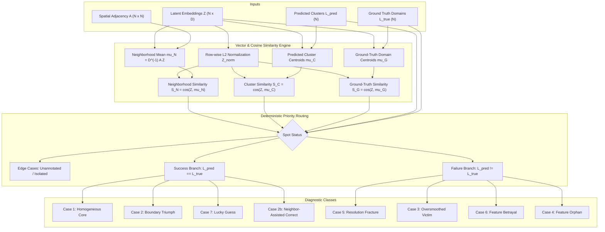
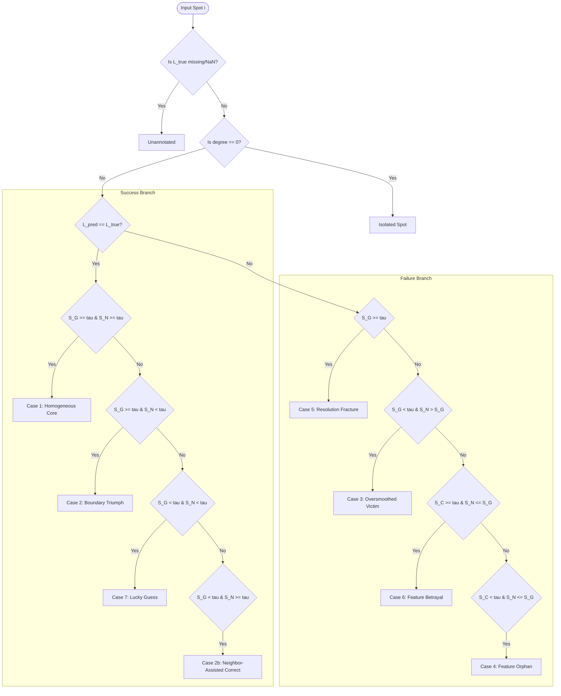

# Micro-Level Topological Diagnostic Framework for Spatial Multi-Omics

An in-depth technical explanation of [`topological_diagnostic.py`](file:///d:/FYDP/GATCON/d1_test/topological_diagnostic.py), detailing its mathematical formulation, vector computations, deterministic priority routing, algorithmic design, and AnnData pipeline integration.

---

## 1. Executive Overview & Motivation

In spatial transcriptomics and multi-omics integration (e.g., Visium, Stereo-seq, MERFISH, STARmap), unsupervised clustering models (such as Spatial GNNs like SMART, ARISE, VGAT, or foundation models like scGPT and UCE) are conventionally evaluated using global, macroscopic metrics such as:
- **Adjusted Rand Index (ARI)**
- **Normalized Mutual Information (NMI)**
- **Silhouette Coefficient (SC)**
- **Clustering Accuracy (ACC)**

### The Problem with Macroscopic Metrics
While global metrics yield a single scalar summarizing overall cluster agreement against manual pathology annotations (ground truth), they are **blind to spatial pathology**:
1. **No Spatial Attribution**: They cannot distinguish whether an error occurred because a Graph Neural Network (GNN) over-smoothed across tissue layer borders, or because single-cell feature artifacts misled the classifier.
2. **Boundary Blindness**: They treat an error occurring deep within a homogeneous organ core identically to a spot on a complex, 1-spot-wide histological boundary.
3. **Spurious Success**: They cannot identify "lucky guesses"—spots where the latent representation had zero affinity to the true biological domain, yet received the correct cluster label purely by chance.

### The Solution: Spot-by-Spot Micro-Audit
[`topological_diagnostic.py`](file:///d:/FYDP/GATCON/d1_test/topological_diagnostic.py) is a **post-processing diagnostic framework**. It requires no model retraining. Instead, it accepts the learned latent embeddings, the physical tissue adjacency graph, predicted cluster assignments, and ground-truth domain annotations, and conducts an individualized geometric and topological audit for every single spot.



---

## 2. Mathematical Formulations & Latent Vectors

For each spot $i \in \{1, \dots, N\}$ in a dataset with embedding dimension $D$:

### 2.1. Embedding Normalization ($Z_{\text{norm}, i}$)
Embeddings extracted from arbitrary deep learning models or matrix factorizations are not necessarily spherical. To perform valid angular similarity comparisons, rows are normalized onto the unit hypersphere:

$$Z_{\text{norm}, i} = \frac{Z_i}{\max(\|Z_i\|_2, \epsilon)}, \quad \epsilon = 10^{-12}$$

Implemented in `_l2_normalize_rows`:
```python
norms = np.linalg.norm(matrix, axis=1, keepdims=True)
valid_norms = np.where(np.isnan(norms) | (norms < eps), eps, norms)
normed = matrix / valid_norms
```

### 2.2. Neighborhood Mean Vector ($\mu_{\mathcal{N}, i}$)
Represents the local micro-environment of spot $i$ in physical space. Let $A \in \mathbb{R}^{N \times N}$ be the spatial adjacency matrix (where $A_{ij} > 0$ if spot $j$ is a physical neighbor of spot $i$, and $A_{ii} = 0$).

$$\mu_{\mathcal{N}, i} = \frac{1}{d_i} \sum_{j=1}^N A_{ij} Z_j, \quad d_i = \sum_{j=1}^N A_{ij}$$

In matrix form:
$$\mu_{\mathcal{N}} = D^{-1} A Z$$

- **Isolated Spots**: If $d_i = 0$, the neighborhood mean is undefined. To avoid division by zero without raising runtime warnings, degrees are masked:
  ```python
  degrees = np.array(A.sum(axis=1)).flatten().astype(float)
  is_isolated = degrees == 0
  safe_degrees = np.where(is_isolated, 1.0, degrees)[:, None]
  mu_N = A.dot(Z) / safe_degrees
  mu_N[is_isolated] = np.nan
  ```

### 2.3. Predicted Cluster Centroid ($\mu_{C, i}$)
Represents the global center of gravity for the predicted cluster $C_k$ that spot $i$ was assigned to ($L_{\text{pred}, i} = k$):

$$\mu_{C, k} = \frac{1}{|C_k|} \sum_{j \in C_k} Z_j, \quad \mu_{C, i} = \mu_{C, L_{\text{pred}, i}}$$

### 2.4. Ground-Truth Domain Centroid ($\mu_{G, i}$)
Represents the biological center of gravity for ground-truth domain $G_m$ that spot $i$ belongs to ($L_{\text{true}, i} = m$):

$$\mu_{G, m} = \frac{1}{|G_m|} \sum_{j \in G_m, \, j \notin \mathcal{U}} Z_j, \quad \mu_{G, i} = \mu_{G, L_{\text{true}, i}}$$

Where $\mathcal{U}$ is the set of unannotated spots (NaN, None, "Unknown", "Exclude").
- **Singleton Handling**: If a domain has only one spot ($|G_m| = 1$), $\mu_{G, i} = Z_i$, producing $S_G(i) = 1.0$ trivially.

### Vectorized Centroid Computation (`_compute_group_centroids`)
To prevent costly $O(N \cdot K)$ nested Python loops, centroids are computed in $O(N \cdot D)$ time using `pd.factorize` and `np.add.at`:
```python
codes, uniques = pd.factorize(sub_labels)
K = len(uniques)
counts = np.bincount(codes, minlength=K)
sums = np.zeros((K, D), dtype=float)
np.add.at(sums, codes, sub_Z)
safe_counts = np.maximum(counts[:, None], 1)
centroids = sums / safe_counts
mu[valid_indices] = centroids[codes]
```

---

## 3. The Three Cosine Similarity Metrics

Because centroid and neighborhood averages do not retain unit norm, they are normalized before dot products. Cosine similarities are computed with vectorized row-wise Einstein summation:

$$S_G(i) = \cos(Z_i, \mu_{G, i}) = Z_{\text{norm}, i} \cdot \mu_{G, \text{norm}, i}$$
$$S_C(i) = \cos(Z_i, \mu_{C, i}) = Z_{\text{norm}, i} \cdot \mu_{C, \text{norm}, i}$$
$$S_N(i) = \cos(Z_i, \mu_{\mathcal{N}, i}) = Z_{\text{norm}, i} \cdot \mu_{\mathcal{N}, \text{norm}, i}$$

```python
S_N = np.einsum("ij,ij->i", Z_norm, mu_N_norm)
S_C = np.einsum("ij,ij->i", Z_norm, mu_C_norm)
S_G = np.einsum("ij,ij->i", Z_norm, mu_G_norm)
```

Values are clipped to $[-1.0, 1.0]$ to guard against numerical float inaccuracies.

| Metric | Name | Interpretation |
|---|---|---|
| **$S_G$** | **Ground-Truth Affinity** | How well does the spot's embedding reflect its annotated biological domain archetype? |
| **$S_C$** | **Cluster Cohesion** | How well does the spot fit into its algorithmic assigned cluster centroid? |
| **$S_N$** | **Local Spatial Agreement** | How consistent is the spot's embedding with its direct spatial neighbors? |

---

## 4. Deterministic Priority Routing & Case Definitions

A default threshold $\tau_{\text{sim}} = 0.85$ (user-configurable) defines high vs. low similarity.

Because geometric conditions can overlap at boundary cases, the framework uses a **strict priority hierarchy** executed via `np.select()`.



### 4.1. Edge Cases (Evaluated First)
1. **`Unannotated`**:
   - Condition: $L_{\text{true}, i} \in \{\text{NaN}, \text{None}, \text{"unknown"}, \text{"exclude"}, \dots\}$.
   - Biological Context: Spot was not annotated by pathologists; success/failure cannot be ascertained. $S_G$ is NaN.
2. **`Isolated Spot`**:
   - Condition: $L_{\text{true}, i}$ is valid, but $d_i = 0$ (degree 0 in $A$).
   - Biological Context: Detached spot, outlier, or edge artifact where no physical neighbors exist. $S_N$ is NaN.

---

### 4.2. Success Branch ($L_{\text{pred}} = L_{\text{true}}$)

#### Case 1: Homogeneous Core
- **Conditions**: $S_G \ge \tau \land S_N \ge \tau$
- **Mechanism**: The spot sits comfortably within the interior of an anatomical structure. Its embedding agrees strongly with both its true domain identity and its physical neighbors.
- **Diagnosis**: Gold-standard cluster assignment.

#### Case 2: Boundary Triumph
- **Conditions**: $S_G \ge \tau \land S_N < \tau$
- **Mechanism**: The spot is located at a physical boundary adjacent to a different anatomical domain. Consequently, its physical neighbors have discordant profiles ($S_N < \tau$). However, the model correctly anchored the spot's embedding to its ground truth ($S_G \ge \tau$) and assigned the correct label.
- **Diagnosis**: Robust feature representation that resisted neighbor contamination at borders.

#### Case 7: Lucky Guess
- **Conditions**: $S_G < \tau \land S_N < \tau$
- **Mechanism**: The spot's embedding has poor alignment with its domain centroid and low alignment with its physical neighbors. Yet, the clustering algorithm happened to assign the correct label.
- **Diagnosis**: Fragile classification. Prone to flipping under different random seeds or parameter perturbations.

#### Case 2b: Neighbor-Assisted Correct
- **Conditions**: $S_G < \tau \land S_N \ge \tau$
- **Mechanism**: The spot's individual feature profile diverges from the global domain centroid, but its spatial neighbors belong to the correct domain and pull the spot into the correct cluster.
- **Diagnosis**: Spatial smoothing rescuing noisy or sparse single-spot measurements. A warning is logged to allow inspection of these residual spots.

---

### 4.3. Failure Branch ($L_{\text{pred}} \neq L_{\text{true}}$)

#### Case 5: Resolution Fracture (Over-clustering)
- **Conditions**: $S_G \ge \tau$ (Checked first in the failure branch)
- **Mechanism**: The spot's embedding aligns strongly with its true biological domain, but the algorithm split this domain into multiple sub-clusters (e.g., Leiden resolution set too high).
- **Diagnosis**: Algorithmic parameter artifact. Resolvable by tuning cluster resolution or merging sub-clusters.

#### Case 3: Oversmoothed Victim
- **Conditions**: $S_G < \tau \land S_N > S_G$
- **Mechanism**: Graph convolutions smoothed the spot's representation toward its physical neighbors from a neighboring domain rather than retaining its biological identity.
- **Diagnosis**: GNN over-smoothing or excessive graph convolution depth.

#### Case 6: Feature Betrayal
- **Conditions**: $S_G < \tau \land S_N \le S_G \land S_C \ge \tau$
- **Mechanism**: The spot does not agree with its neighbors, but it aligns strongly with an incorrect cluster centroid. This typically indicates dominant batch effects, sequencing artifacts, or mitochondrial/stress signatures overriding true domain genetics.
- **Diagnosis**: Feature pre-processing / normalization failure.

#### Case 4: Feature Orphan
- **Conditions**: $S_G < \tau \land S_N \le S_G \land S_C < \tau$
- **Mechanism**: The spot fails along all three axes: it does not match its ground-truth domain, does not match its spatial neighborhood, and does not even fit into its assigned cluster centroid.
- **Diagnosis**: Extreme outlier, low sequencing depth, or dead cell / technical noise.

---

### 4.4. Safety Net: `Unclassified`
If any spot ever falls through the decision tree, it is assigned `"Unclassified"`, and a high-priority error is logged. In unit tests and formal proof, the branch conditions form a complete partition, so `Unclassified` count is always 0.

---

## 5. Architectural Breakdown of Functions

[`topological_diagnostic.py`](file:///d:/FYDP/GATCON/d1_test/topological_diagnostic.py) is modularized into four primary interfaces:

### 1. `_l2_normalize_rows(matrix, eps=1e-12)`
- Vectorized row normalization with NaN propagation protection and zero-norm safeguards.

### 2. `_compute_group_centroids(Z, labels, valid_mask=None)`
- Computes group centroids using integer encoding (`pd.factorize`) and vectorized accumulation (`np.add.at`).
- Returns `(mu, group_sizes)`.

### 3. `topological_diagnostic(...)`
The core engine.
```python
def topological_diagnostic(
    Z: np.ndarray,
    A: sp.spmatrix,
    L_pred: Union[np.ndarray, pd.Series, Sequence],
    L_true: Union[np.ndarray, pd.Series, Sequence],
    tau_sim: float = 0.85,
    spot_ids: Optional[Union[np.ndarray, pd.Series, Sequence]] = None,
    unannotated_values: Optional[Set[Any]] = None,
) -> pd.DataFrame
```
- Performs input validation (ensuring 2D $Z$, CSR sparse $A$, matching lengths $N$).
- Executes Part 1 (vector computation), Part 2 (`np.select` priority routing), and Part 3 (DataFrame construction).
- Returns a DataFrame with columns:
  `['spot_id', 'L_pred', 'L_true', 'S_G', 'S_C', 'S_N', 'degree', 'case']`.

### 4. `summarize_topological_diagnostic(...)`
Generates aggregate reporting tables:
```python
def summarize_topological_diagnostic(
    df_diagnostic: pd.DataFrame,
    sample_col: Optional[Union[str, Sequence]] = None,
) -> pd.DataFrame
```
- Computes spot counts and percentage frequencies per case.
- Supports multi-sample breakdowns when a `sample_col` is provided.

### 5. `topological_diagnostic_from_adata(...)`
The production adapter for AnnData / Scanpy workflows:
```python
def topological_diagnostic_from_adata(
    adata: Any,
    cluster_key: str = "leiden",
    ground_truth_key: str = "ground_truth",
    embedding_key: str = "joint_feat",
    spatial_key: str = "spatial",
    adj_key: Optional[str] = None,
    n_neighbors: int = 6,
    tau_sim: float = 0.85,
    inplace: bool = True,
    unannotated_values: Optional[Set[Any]] = None,
) -> Tuple[pd.DataFrame, pd.DataFrame]
```
- Automatically discovers embeddings from `adata.obsm[embedding_key]` or `adata.X`.
- Automatically extracts spatial adjacency from `adata.uns[adj_key]`, `adata.obsp['spatial_connectivities']`, or dynamically constructs a KNN graph (`kneighbors_graph`) from spatial coordinates (`adata.obsm['spatial']`).
- When `inplace=True`, annotates the AnnData object directly:
  - `adata.obs['topological_case']`
  - `adata.obs['S_G']`, `adata.obs['S_C']`, `adata.obs['S_N']`
  - `adata.obs['topological_degree']`
  - `adata.uns['topological_diagnostic_summary']`

---

## 6. Comprehensive Case Decision Table

| Branch | Case Name | Case ID | Condition Formula | Diagnostic Action / Interpretation |
|---|---|---|---|---|
| **Edge** | Unannotated | `Unannotated` | $L_{\text{true}} \in \text{UnannotatedSet}$ | Spot excluded from supervised evaluation. |
| **Edge** | Isolated Spot | `Isolated Spot` | $\text{degree} = 0 \land L_{\text{true}} \text{ valid}$ | Zero physical neighbors; neighborhood undefined. |
| **Success** | Homogeneous Core | `Case 1` | $S_G \ge \tau \land S_N \ge \tau$ | Ideal cluster performance within tissue core. |
| **Success** | Boundary Triumph | `Case 2` | $S_G \ge \tau \land S_N < \tau$ | Model resisted spatial mixing at domain boundaries. |
| **Success** | Lucky Guess | `Case 7` | $S_G < \tau \land S_N < \tau$ | Low affinity to domain & neighbors; fragile assignment. |
| **Success** | Neighbor-Assisted | `Case 2b` | $S_G < \tau \land S_N \ge \tau$ | Spatial neighbors helped rescue a weak feature profile. |
| **Failure** | Resolution Fracture | `Case 5` | $S_G \ge \tau$ | High biological affinity, but split by over-clustering. |
| **Failure** | Oversmoothed Victim | `Case 3` | $S_G < \tau \land S_N > S_G$ | Graph convolution pulled spot toward neighbor domain. |
| **Failure** | Feature Betrayal | `Case 6` | $S_G < \tau \land S_N \le S_G \land S_C \ge \tau$ | Technical artifact / noise aligned with wrong cluster. |
| **Failure** | Feature Orphan | `Case 4` | $S_G < \tau \land S_N \le S_G \land S_C < \tau$ | Uncorrelated outlier; low sequencing depth or artifact. |
| **Safety** | Unclassified | `Unclassified` | Fell through all conditions | Logic gap indicator (should never occur). |

---

## 7. How to Run & Verify

### Running the Built-in Synthetic Demonstration
```bash
python topological_diagnostic.py
```
This executes the self-contained demonstration in `if __name__ == "__main__":`, constructing a synthetic graph engineering all 7 cases + edge cases and printing the formatted audit.

### Running the Test Suite
The implementation includes a complete unit test suite in [`test_topological_diagnostic.py`](file:///d:/FYDP/GATCON/d1_test/test_topological_diagnostic.py):
```bash
pytest test_topological_diagnostic.py
```
Tests cover:
1. `test_neighborhood_mean_vectorization`: Numerical equivalence against reference slow Python loops.
2. `test_centroid_computation_and_singleton`: Exact centroid math and singleton group behavior ($S_G = 1.0$).
3. `test_synthetic_toy_graph_cases`: Verification that all 7 cases + edge cases trigger on engineered vectors.
4. `test_degenerate_cases`: Empty graphs, identical vectors, singletons without numerical NaNs or errors.
5. `test_partition_completeness_and_mutual_exclusivity`: 100% partitioning with zero unclassified spots.
6. `test_custom_unannotated_values`: Custom string handling for missing labels.

---

## 8. Usage in Downstream Spatial Pipelines

```python
import scanpy as sc
from topological_diagnostic import topological_diagnostic_from_adata

# Load spatial transcriptomics dataset
adata = sc.read_h5ad("spatial_data.h5ad")

# Run diagnostic directly on AnnData object
diag_df, summary_df = topological_diagnostic_from_adata(
    adata,
    cluster_key="leiden",
    ground_truth_key="ground_truth",
    embedding_key="joint_feat",
    spatial_key="spatial",
    tau_sim=0.85,
    inplace=True,
)

# Display summary statistics
print(summary_df)

# Spatial visualization of diagnostic cases across the tissue slice
sc.pl.spatial(
    adata,
    color=["topological_case", "S_G", "S_N"],
    spot_size=30,
    title=["Topological Audit", "Domain Affinity (S_G)", "Neighbor Agreement (S_N)"],
)
```
This spatial plot immediately reveals:
- **Case 3 (Oversmoothed)** spots aligned along histological boundary lines.
- **Case 5 (Resolution Fracture)** patches showing where an anatomical domain was artificially split.
- **Case 6 (Feature Betrayal)** and **Case 4 (Feature Orphan)** spots highlighting technical noise or tissue damage.
